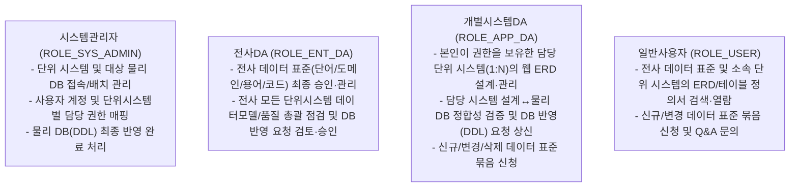
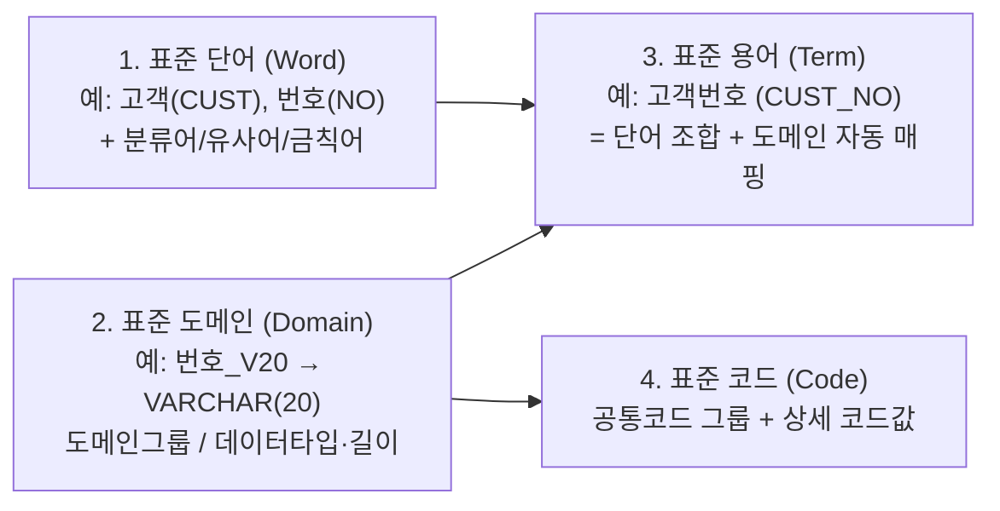
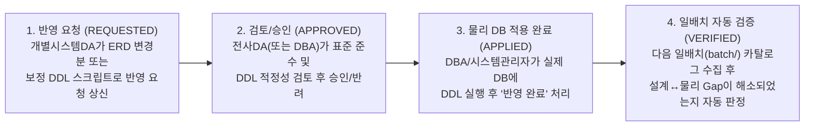

# 01. 시스템 비전 및 요구사항 정의서 (Requirements Specification)

## 1. 시스템 개요 및 최종 목표 (Vision & Objectives)
**My Data Portal**은 전사 데이터 표준을 체계적으로 관리하고, 단위 시스템별 데이터 설계안(ERD)을 웹에서 직접 작성·시각화하며, 해당 설계안이 실제 물리 데이터베이스에 정확히 구현되었는지(설계 ↔ 물리 정합성)를 비교·검증하는 **데이터 거버넌스 및 모델링 포털 시스템**이다.

### 1.1 핵심 가치 (4대 축)
1. **데이터 표준화 (Data Standardization)**: 표준 단어·도메인·용어·코드의 정의, 변경 영향도(Where-Used) 분석, 다건 묶음 신청/승인 프로세스를 통한 전사 명명 규칙 통일
2. **웹 기반 데이터 설계 (Interactive Web ERD Modeling)**: 표준 용어와 실시간 연동되는 인터랙티브 웹 ERD 캔버스 및 테이블/컬럼/인덱스 정의서 관리
3. **설계 ↔ 물리 DB 정합성 보장 (Gap & Consistency Verification)**: 일배치로 수집된 실제 물리 DB 카탈로그와 설계 모델을 정밀 비교하여 미구현·불일치 객체를 검출하고 양방향 동기화(보정 DDL 생성 / DB 반영 요청 / 역공학) 지원
4. **통합 신청·결재 및 커뮤니케이션 (Workflow & Portal Board)**: 개인화 워크플레이스 대시보드, 다건 묶음 신청/부분 승인, 물리 DB(DDL) 반영 요청 라이프사이클, 표준화 가이드/Q&A 게시판 제공

---

## 2. 표준 용어 및 약어 정의 (Glossary & Terminology)

본 설계서 전반에서 사용하는 핵심 도메인 용어의 정의는 다음과 같다.

| 용어 (한글) | 영문 표기 / 약어 | 상세 정의 |
| --- | --- | --- |
| **단위 시스템** | `Target System` | 포털에서 데이터 모델(ERD)과 물리 DB 정합성을 관리하는 대상 업무 시스템 단위 (예: 주문관리 `ORD`, 인사관리 `HR`, 정산관리 `STL`) |
| **전사 DA** | `Enterprise DA (ENT_DA)` | 전사 데이터 표준(단어·도메인·용어·코드)을 제·개정 및 승인하고 전사 모델 품질을 총괄하는 데이터 아키텍트 |
| **개별시스템 DA** | `Application DA (APP_DA)` | 본인이 권한을 부여받은 담당 단위 시스템의 논리/물리 데이터 모델(ERD)을 설계하고 DB 정합성을 관리하는 담당자 |
| **분류어 (형식단어)** | `Class Word` | 표준 용어의 가장 마지막에 위치하여 데이터의 성격을 규정하고 선택 가능한 **표준 도메인 그룹**을 결정하는 단어 (예: `번호`, `일자`, `금액`, `코드`, `명`, `여부`) |
| **금칙어 / 유사어** | `Forbidden Word / Synonym` | 사용이 금지된 비표준 단어(예: `손님`, `핸드폰`, `날짜`)로, 검색·신청 시 지정된 대체 표준 단어(예: `고객`, `휴대전화`, `일자`)를 안내함 |
| **표준 도메인** | `Standard Domain` | 데이터의 논리적 유형과 물리적 데이터 타입·길이·소수점을 정의한 기준 (예: `번호_V20` → `VARCHAR(20)`) |
| **표준 용어** | `Standard Term` | 테이블의 컬럼(속성) 표준으로, `1개 이상의 표준 단어 조합 + 마지막 분류어에 매핑된 표준 도메인`으로 구성된 항목 |
| **묶음 신청서** | `Bundle Request` | 표준 단어·용어·코드의 신규/변경/삭제 요청 여러 건을 장바구니에 담아 1건의 결재 단위로 상신하는 신청서 (1 마스터 : N 상세 항목) |
| **물리 카탈로그** | `Physical DB Catalog` | `batch/` 애플리케이션이 대상 물리 DB의 시스템 카탈로그(`information_schema`, `pg_catalog`)에서 일배치로 수집해 포털 DB에 적재한 실제 테이블·컬럼·제약·인덱스 메타데이터 |
| **정합성 (갭) 진단** | `Gap Verification` | 포털의 데이터모델(설계)과 물리 카탈로그(실제 DB)를 비교하여 미구현 테이블/컬럼, 타입·길이·PK·인덱스 불일치 등을 검출하는 진단 작업 |
| **역공학 (역반영)** | `Reverse Engineering / Sync` | 실제 물리 DB에 존재하는 테이블·컬럼·인덱스 메타데이터를 읽어와 포털의 웹 ERD 설계 모델로 생성·동기화하는 기능 |
| **영향도 분석** | `Where-Used / Impact Analysis` | 특정 단어·도메인·용어가 변경/삭제될 때 이를 참조하고 있는 하위 용어 및 단위시스템별 모델 테이블·컬럼을 역추적하는 기능 |

---

## 3. 사용자 역할 및 권한 체계 (User Roles & Permissions)

포털 사용자는 **4가지 역할(Role)**로 구분되며, **`사용자 ↔ 단위 시스템(Target System) ↔ 역할`** 매핑을 통해 담당 업무 시스템 범위와 권한이 부여된다.

| 역할명 | 역할 코드 | 단위시스템 권한 범위 | 주요 권한 및 책임 범위 |
| --- | --- | --- | --- |
| **시스템관리자** | `ROLE_SYS_ADMIN` | 전사 전체 단위시스템 | - 관리 대상 **단위 시스템(업무 시스템)** 등록/수정/삭제 - 단위 시스템별 **물리 DB 접속 정보(JDBC)** 등록, 경량 연결 테스트, 온디맨드 배치 수집 요청 - 사용자 역할 부여 및 `사용자 ↔ 단위 시스템` 권한 매핑 관리 - 승인된 **데이터베이스 반영(DDL) 요청**의 실제 DB 적용 후 `반영완료` 처리 |
| **전사DA** | `ROLE_ENT_DA` | 전사 전체 단위시스템 | - 전사 데이터 표준(**단어·도메인·용어·코드**) 직접 등록/수정 및 **묶음 신청 건(전체 또는 항목별 부분) 승인·반려** - 전사 모든 단위 시스템의 데이터 설계(ERD) 열람, 표준 준수율·DB 정합성 총괄 진단 - 개별시스템DA가 상신한 **데이터베이스 반영(DDL) 요청 검토 및 승인/반려** |
| **개별시스템DA** | `ROLE_APP_DA` | 매핑된 담당 단위시스템 (1:N) | - **담당 단위 시스템**의 데이터 설계안(웹 ERD 및 테이블/컬럼/인덱스 정의서) 생성·수정·삭제 - 담당 시스템의 **데이터 표준 준수 진단** 및 **설계 ↔ 물리 DB 정합성(Gap) 진단** 실행 - 설계 변경분 또는 갭 보정 DDL에 대한 **데이터베이스 반영(DDL) 요청 상신** 및 물리 DB → 설계 역반영(Sync) - 데이터 표준(**단어·용어·코드**) 다건 묶음 신청 |
| **일반사용자** | `ROLE_USER` | 소속/열람 허용 단위시스템 | - 데이터 표준 사전 및 단위 시스템별 ERD/테이블·컬럼 정의서·물리 DB 카탈로그 검색·조회 - 데이터 표준(**단어·용어·코드**) 다건 묶음 신청 및 게시판(Q&A) 작성 |

---

## 4. 도메인별 상세 기능 요구사항 (Functional Requirements)

### 4.1 시스템 관리 (`system` — 시스템관리자 영역)
- **단위 시스템 관리 (`Target System`)**
  - 시스템 코드(예: `ORD`, `HR`, `STL`), 시스템명(예: 주문관리, 인사시스템, 정산시스템), 설명, 사용 여부를 관리한다.
- **사용자 및 단위시스템 권한 매핑 관리 (`User & System Authorization`)**
  - 사용자 기본 정보 및 포털 역할(`ROLE_SYS_ADMIN`, `ROLE_ENT_DA`, `ROLE_APP_DA`, `ROLE_USER`)을 관리한다.
  - 특정 사용자에게 권한을 가지는 **담당 단위 시스템(1:N)**을 매핑하여, 메인 대시보드의 **'내가 권한을 가지는 대상 현황'**에 표시하고 모델 편집 권한을 제어한다.
- **대상 물리 DB 연결 및 수집 관리 (`Database Connection & Batch Trigger`)**
  - 각 단위 시스템에 매핑되는 실제 물리 DB 접속 정보(DBMS 종류, Host, Port, DB명, 수집 대상 스키마 목록, Read-Only 계정명, AES-256 암호화 비밀번호, 일배치 수집 활성화 여부)를 관리한다.
  - **온라인/배치 경계 원칙**:
    - **`[DB 연결 테스트]`**: 관리자가 접속 정보를 입력·검증할 때만 예외적으로 온라인 백엔드(`backend/`)에서 3초 타임아웃의 경량 `SELECT 1` 핑(Ping) 접속 여부만 확인하며, 메타데이터 조회는 수행하지 않는다.
    - **`[즉시 수집(온디맨드 배치) 요청]`**: 관리자가 화면에서 수동 카탈로그 수집을 요청하면 포털 DB에 수집 요청 상태를 기록하거나 `batch/` 애플리케이션을 비동기 트리거하여, 모든 카탈로그 수집 로직이 `batch/` 프로젝트로 일원화되도록 한다.

---

### 4.2 데이터 표준 관리 (`standard` — 단어·도메인·용어·코드·영향도·개정이력)

데이터 표준은 **① 표준 단어 → ② 표준 도메인 → ③ 표준 용어 → ④ 표준 코드**의 4대 체계로 관리한다.

#### ① 표준 단어 사전 (`Standard Word`)
- **관리 속성**: 한글 단어명, 영문 약어(예: `CUST`), 영문 정식명(`Customer`), 단어 설명, **분류어(형식단어) 여부**, 매핑 도메인 그룹, 버전 번호, 상태(승인/신청중/반려).
- **분류어(Class Word) 관리**: 용어의 맨 끝에 위치하여 데이터의 성격을 결정하는 단어(예: `번호`, `일자`, `금액`, `명`, `코드`, `여부`)를 분류어로 지정하고, 해당 분류어가 선택할 수 있는 **도메인 그룹**을 연결한다.
- **유사어/금칙어 관리**: 비표준 단어(예: `손님`, `날짜`, `핸드폰`)를 금칙어/유사어로 등록하고 대체 표준 단어(예: `고객`, `일자`, `휴대전화`)를 연결한다. 사용자가 금칙어로 검색하거나 신청 시 대체 표준 단어를 즉시 안내한다.

#### ② 표준 도메인 사전 (`Standard Domain`)
- **관리 속성**: 도메인 그룹(예: `번호`, `금액`, `날짜`, `명칭`, `코드`), 도메인 논리명(예: `전화번호_V20`), 논리 데이터 타입, 물리 데이터 타입(예: `VARCHAR`), 길이(`20`), 소수점 자리수, 설명.
- **권한**: 데이터의 물리적 타입/길이를 결정하는 핵심 기준이므로 **전사DA**가 등록·관리한다 (일반사용자/개별시스템DA는 신규 도메인이 필요한 경우 요청 가능).

#### ③ 표준 용어 사전 (`Standard Term` — 컬럼 표준)
- **엄격한 표준 조합 규칙**:
  - 표준 용어는 반드시 **등록된(또는 동일 묶음 신청서에 함께 담긴) '표준 단어'들의 조합 + 마지막 단어(분류어)에 연결된 '표준 도메인' 선택**으로만 생성된다.
  - 단어 조합 시 영문 컬럼명(예: `고객` + `전화` + `번호` → `CUST_TEL_NO`)이 언더스코어(`_`)로 자동 조합되며, 선택한 표준 도메인에 따라 물리 데이터 타입과 길이(예: `VARCHAR(20)`)가 자동 부여된다.

#### ④ 표준 코드 사전 (`Standard Code`)
- **코드 그룹**: 표준 코드 ID, 코드 그룹명(예: `결제수단코드`), 연결 표준 도메인, 설명, 사용 여부
- **코드 상세값**: 코드값(예: `CARD`, `BANK`), 코드값 명칭(예: `신용카드`, `계좌이체`), 정렬 순서, 사용 여부

#### ⑤ 표준 참조 영향도 분석 (`Where-Used / Impact Analysis`) 및 삭제 보호
- **역방향 참조(Where-Used) 조회**:
  - 특정 `표준 단어` 선택 시 해당 단어가 포함된 `표준 용어 목록`과 실제 적용된 `단위시스템별 모델 테이블/컬럼 목록`을 즉시 조회한다.
  - 특정 `표준 도메인` 또는 `표준 용어` 선택 시 이를 참조 중인 하위 용어·코드·모델 컬럼 목록을 조회한다.
- **삭제 보호 및 변경 영향 경고**:
  - 하위 용어나 데이터모델 컬럼에서 현재 참조 중인 단어·도메인·용어는 **삭제 신청을 차단(참조 해제 후 삭제 가능 안내)**한다.
  - 이미 사용 중인 도메인이나 용어의 속성을 변경 신청할 경우, 영향을 받는 모델 컬럼 건수를 신청 화면과 결재 화면에 자동 표시한다.

#### ⑥ 표준 개정 이력 관리 (`Standard Revision History`)
- 표준 단어·도메인·용어·코드가 최초 승인(`v1`)되거나 변경 승인(`v2`, `v3`...)될 때마다 **버전 번호, 변경 유형(제정/개정/폐기), 변경 전/후 속성 스냅샷, 신청자, 승인자, 승인 일시, 변경 사유**를 이력으로 보존하고 화면에서 조회할 수 있어야 한다.

---

### 4.3 데이터 모델 관리 (`model` — 웹 ERD 및 테이블/컬럼/인덱스 정의서)

`개별시스템DA`는 담당 단위 시스템의 논리/물리 데이터 모델을 **포털 내 웹 ERD 도구**에서 직접 작성·관리한다.

#### ① 스키마(`schema_name`) 기준 테이블 식별 및 인덱스(Index) 관리
- **고유 식별 기준**: 하나의 단위 시스템 물리 DB 내에 복수의 스키마(예: `public`, `ord_app`, `pay_app`)가 존재할 수 있으므로, 모든 설계 테이블과 물리 테이블은 **`단위시스템 + 스키마명(schema_name) + 테이블 물리명(table_name)`** 조합을 고유 식별 키(Unique Key)로 관리한다.
- **인덱스(Index) 설계 관리**: 테이블별로 **인덱스 물리명, Unique 여부, 복합 인덱스 구성 컬럼 목록 및 컬럼별 정렬 순서(`ASC`/`DESC`)**를 설계·편집하고 DDL 생성 및 물리 DB Gap 비교 대상에 포함한다.

#### ② 인터랙티브 웹 ERD 모델러 (캔버스 + 그리드 하이브리드)
- **시각적 ERD 캔버스 조작**:
  - 웹 화면(React Flow 기반 캔버스)에서 **테이블(엔티티) 노드 추가, 마우스 드래그를 통한 위치 배치(X, Y 좌표 저장), 확대/축소(Zoom/Pan), 미니맵(MiniMap)** 기능을 제공한다.
  - 테이블 간 **PK ↔ FK 관계선(1:1, 1:N, 식별/비식별 관계)을 마우스 드래그로 연결·편집**할 수 있다.
  - 상단 토글을 통해 **[논리 모델 뷰(한글)] / [물리 모델 뷰(영문)] / [논리+물리 통합 뷰]**를 실시간 전환한다.
- **표준 용어 연동 컬럼/인덱스 편집기 (양방향 실시간 동기화)**:
  - 캔버스에서 테이블 선택 시 하단 편집 패널에서 컬럼 목록(논리명, 물리명, 표준용어 매핑ID, 도메인, 데이터 타입/길이, PK 여부, FK 여부, Not Null 여부, Default 값, 설명)과 인덱스 목록을 편집한다.
  - 컬럼 추가 시 **표준 용어 사전을 검색·선택**하면 영문 컬럼명과 데이터 타입/길이가 자동 입력되며, 캔버스의 테이블 박스에도 즉시 반영된다.

#### ③ 표준 미준수 예외 허용 및 모델 변경 이력 관리
- **원칙적 표준 강제 + 예외적 비표준 허용**:
  - 신규 컬럼 설계 시 표준 용어 매핑을 기본으로 하되, 레거시 DB 역공학(Import)이나 외부 패키지 테이블 수용 등 불가피한 경우 **`[표준 예외(비표준) 허용 여부]`와 `예외 사유`를 입력하여 비표준 컬럼으로도 모델을 저장**할 수 있다.
  - 비표준 컬럼은 ERD 노드와 컬럼 그리드에 **`[비표준]` 경고 배지**로 표시되며, **`4.1 데이터 표준 준수 진단`** 메뉴에서 검출 대상으로 자동 집계된다.
- **모델 변경 이력 추적**: 설계 테이블/컬럼/인덱스가 추가·수정·삭제될 때마다 변경 이력(수정자, 수정 일시, 변경 내역)을 기록한다.

---

### 4.4 데이터베이스 및 품질 진단 (`verification` — 물리 DB 카탈로그 & 정합성 검증)

#### ① 물리 DB 메타데이터 배치(`batch/`) 수집 및 적재
- **온라인 서버(`backend/`)와 배치 서버(`batch/`) 물리적 분리**:
  - 별도로 분리된 **Spring Batch 애플리케이션(`batch/`)**이 **일 단위 정기 배치(Daily Batch)**를 통해 대상 물리 DB의 카탈로그 메타데이터(**스키마, 테이블, 컬럼, 타입/길이, Nullable, Default, PK/FK 제약조건, 인덱스(Index), Comment**)를 수집하고, 직전 적재분과의 변경사항(`ADDED`, `MODIFIED`, `DELETED`)을 판별하여 **포털 메타데이터 DB(`mydataportal`) 내에 적재**한다.
  - 온라인 화면(`3.1 물리 테이블/컬럼 조회`, `3.2 물리 DB 일별 변경 이력`, `4.2 설계 ↔ 물리 DB 일치 진단`)은 모두 **포털 DB에 적재된 물리 카탈로그 마스터 및 이력 테이블**을 조회하여 고속으로 동작한다.
- **1차 지원 DBMS**: **PostgreSQL** (`TargetDbCatalogCollector` Strategy 패턴으로 설계하여 추후 Oracle, MySQL 등으로 확장 용이).

#### ② 정합성(Gap / Diff) 정밀 비교 기준
설계안(데이터모델)과 적재된 물리 DB(데이터베이스)를 **`단위시스템 + 스키마명 + 테이블 물리명`** 기준으로 매칭하여 아래 유형으로 판정한다.

| 비교 수준 | 판정 상태 | 상세 기준 |
| --- | --- | --- |
| **테이블 수준** | `MATCHED` (완전 일치) | 설계 테이블이 물리 DB 동일 스키마에 존재하며 하위 컬럼/제약조건/인덱스도 모두 일치 |
| | `MISSING_IN_DB` (물리 DB 미구현) | 설계안(ERD)에는 있으나 실제 물리 DB에 아직 생성되지 않은 테이블 |
| | `EXTRA_IN_DB` (설계 누락) | 실제 물리 DB에는 존재하나 설계안(ERD)에 등록되지 않은 테이블 |
| | `MODIFIED` (속성 불일치) | 테이블은 양쪽에 존재하나 컬럼·타입·제약조건·인덱스 등에 차이가 있는 상태 |
| **컬럼/제약/인덱스 수준** | `MISSING_COLUMN` | 설계에만 있고 물리 DB 테이블에 누락된 컬럼 |
| | `EXTRA_COLUMN` | 물리 DB 테이블에만 있고 설계에 없는 컬럼 |
| | `TYPE_MISMATCH` | 데이터 타입 또는 길이/정밀도(Length/Precision/Scale) 불일치 |
| | `NULLABLE_MISMATCH` | `NOT NULL` 여부 불일치 |
| | `KEY_MISMATCH` | PK / FK 구성 불일치 |
| | `INDEX_MISMATCH` | 인덱스 존재 여부, Unique 여부, 구성 컬럼/순서 불일치 |
| | `COMMENT_MISMATCH` | 설계 한글 논리명과 물리 DB 테이블/컬럼 `COMMENT` 불일치 |

#### ③ 불일치 해결을 위한 양방향 조치(Action)
- **설계 → 물리 DB 방향 (보정 DDL 자동 생성 및 DB 반영 요청 연동)**:
  - 검출된 불일치 항목을 해결하기 위해 물리 DB에 적용할 **`CREATE TABLE` / `ALTER TABLE` / `CREATE INDEX` / `COMMENT ON`** 보정 DDL 스크립트를 자동 생성하고, 이를 즉시 **`5.4 데이터베이스 반영(DDL) 요청`**으로 상신할 수 있다.
- **물리 DB → 설계 방향 (설계안 역반영 Sync)**:
  - 물리 DB에 먼저 추가·변경된 테이블이나 컬럼·인덱스(`EXTRA_IN_DB`, `EXTRA_COLUMN` 등)를 선택한 뒤 **[설계에 역반영]** 버튼을 누르면 웹 ERD 설계안이 물리 DB 기준으로 업데이트된다.

---

### 4.5 통합 신청/결재 워크플로우 (`workflow`)

#### ① 데이터 표준 다건 묶음 신청 (1 신청서 : N 신청 항목) 및 연관 신청 규칙
- **팝업 없는 인라인 신청 바구니(Batch Request Basket)**:
  - 사용자는 표준 조회 화면 하단의 신청 바구니에 **신규 등록(`CREATE`), 기존 항목 변경(`UPDATE`), 삭제(`DELETE`)** 대상 여러 건을 담아 **1건의 묶음 신청서(신청 마스터 1건 + 신청 상세 항목 N건)**로 일괄 상신한다.
- **미등록 단어 + 신규 용어 동시 연관 신청 허용**:
  - 신규 용어(예: `고객식별번호`)를 조합할 때 사전에 없는 단어(예: `식별`)가 포함되어 있다면, 하나의 묶음 신청서 안에 **`[표준단어 신규 신청: 식별(IDNT)]` 항목과 `[표준용어 신규 신청: 고객식별번호(CUST_IDNT_NO)]` 항목을 함께 담아 동시 상신**할 수 있다.
- **전체 승인/반려 및 항목별 부분 승인(Partial Approval) 규칙**:
  - 결재권자(`전사DA`)는 묶음 신청서 내 N개의 상세 항목을 검토할 때 **전체 일괄 승인/반려**할 수 있을 뿐만 아니라, 기준에 미달하는 특정 항목만 개별 **`반려(사유 입력)`**하고 나머지 정상 항목들은 **`승인`(부분 승인)** 처리할 수 있다.
  - 단, 선행 단어 신청 항목이 반려된 경우 해당 단어를 참조하는 후행 용어 신청 항목은 함께 반려되도록 정합성을 검증한다.

#### ② 데이터베이스 반영(DDL) 요청 라이프사이클
운영/개발 물리 DB의 안전성을 보장하기 위해 포털이 물리 DB에 직접 DDL을 실행하지 않고, 아래의 **4단계 반영 및 자동 검증 라이프사이클**로 관리한다.

---

### 4.6 게시판 및 커뮤니케이션 (`board`)
- **6.1 공지사항 (`NOTICE`)**: 전사 데이터 표준 개정 안내, 일배치 점검 공지 등 (중요 공지 상단 고정 지원)
- **6.2 표준화 가이드 / 자료실 (`GUIDE`)**: 전사 명명 규칙 지침서, 도메인 정의 기준, ERD 모델링 가이드라인 문서 공유
- **6.3 Q&A 문의/건의 (`QNA`)**: 표준 단어/용어 신청 관련 질의응답 및 모델링 문의 등록·답변 관리

---

### 4.7 개인화 메인 대시보드 (`dashboard` — 포털 기본 홈 화면)
포털 접속 시 가장 먼저 열리는 메인 대시보드는 **현재 로그인(선택)한 사용자의 업무 현황 4대 카드**와 전사 요약 지표를 제공한다.
1. **내가 신청한 등록 요청 현황 (`My Requests`)**: 내가 상신한 묶음 신청서 및 DB 반영 요청의 상태별 건수(`검토중`, `승인완료`, `부분승인`, `반려`)와 최근 목록
2. **내 결재 대기 대상 현황 (`Pending Approvals`)**: 현재 사용자의 역할(`전사DA`, `시스템관리자` 등)에 따라 내가 승인/검토해야 할 결재 대기 건수 및 즉시 결재 이동 링크
3. **내가 권한을 가지는 단위시스템 현황 (`My Authorized Systems`)**: 나에게 권한이 부여된 담당 단위 시스템 목록과 각 시스템의 설계 테이블/컬럼 수, **데이터 표준 준수율(%)**, **설계↔물리 DB 일치율(%)**, 웹 ERD 바로가기
4. **데이터베이스(물리 DB) 반영 요청 현황 (`DB Reflection Requests`)**: 담당 시스템의 DDL 반영 요청 진행 상태(`반영요청`, `검토승인`, `DB반영완료`, `배치검증완료`) 및 최근 일배치 카탈로그 수집 일시

---

## 5. 비기능 요구사항 (Non-Functional Requirements — NFR)

| 구분 | 요구사항 항목 | 상세 기준 및 목표치 |
| --- | --- | --- |
| **성능 (Performance)** | 온라인 조회 및 캐싱 응답속도 | - 표준 사전(단어·도메인·용어·코드) 검색 및 자동완성 API 응답시간 **0.5초 이내** (Redis Look-Aside 캐시 활용) - 포털 DB에 적재된 물리 카탈로그 기반 단위시스템별 Gap 비교(테이블 200개, 컬럼 3,000개 기준) 응답시간 **2초 이내** |
| **운영 DB 격리 및 안정성 (Isolation & Safety)** | 온라인/배치 분리 및 DDL 직접 실행 금지 | - 온라인 서버(`backend/`)는 대상 물리 DB 카탈로그를 직접 조회하지 않음 (`[DB 연결 테스트]` 시 3초 타임아웃 `SELECT 1`만 예외 허용) - 포털은 대상 물리 DB에 `CREATE`/`ALTER`/`DROP` 등 DDL을 직접 실행하지 않으며, 오직 Read-Only JDBC로 카탈로그만 수집함 |
| **보안 (Security)** | 민감정보 암호화 및 역할 기반 접근제어 | - 대상 물리 DB 접속 비밀번호는 반드시 **AES-256 양방향 암호화**하여 DB에 저장하고, API 응답 시 마스킹(`********`) 처리함 - 모든 변경/승인 API는 역할(`Role`) 및 담당 단위시스템 권한을 서버 측에서 검증함 |
| **동시성 및 정합성 (Concurrency & Integrity)** | 다중 사용자 동시 편집 충돌 방지 | - 웹 ERD 테이블/컬럼 저장 및 표준 사전 수정 시 **낙관적 락(`@Version`)**을 적용하여 타 사용자의 선행 수정 내역 덮어쓰기를 방지함 |
| **가용성 및 배치 복원력 (Availability & Batch Resilience)** | 캐시 장애 격리 및 배치 멱등성 | - Redis 일시 장애 시에도 RDB(PostgreSQL) 조회로 자동 우회(Fallback)되어 서비스 중단이 없어야 함 - 일배치(`batch/`) 재실행 시 동일 일자 데이터가 중복 적재되지 않도록 **멱등성(Idempotency)**을 보장함 |
| **감사 및 추적성 (Auditability)** | 모든 엔티티 감사 필드 및 개정 이력 보존 | - 모든 테이블에 생성자(`created_by`), 생성일시(`created_at`), 수정자(`updated_by`), 수정일시(`updated_at`)를 기록하고 표준 및 모델 변경 이력을 추적함 |

---

## 6. 제약사항 및 전제조건 (Constraints & Assumptions)
1. **1차 대상 물리 DBMS**: 초기 구축 단계에서는 **PostgreSQL (v14~v16)**을 1차 수집 대상 DBMS로 지원하며, `TargetDbCatalogCollector` 인터페이스를 통해 추후 Oracle, MySQL, MariaDB로 확장한다.
2. **로컬/개발 테스트용 타겟 물리 DB 구성**: 별도의 외부 운영 DB가 없는 로컬 개발 환경에서도 배치 수집(`batch/`)과 설계↔물리 Gap 진단을 100% 검증할 수 있도록, 포털 PostgreSQL 컨테이너 내에 **샘플 단위시스템 물리 스키마(예: `sample_ord` 주문시스템, `sample_hr` 인사시스템)**를 함께 구성한다.
3. **인증 체계 단계적 적용**: Phase 1~3까지는 상단 **역할 전환기(Role Switcher — `X-Portal-Role`, `X-Portal-User-Id` 헤더)**를 통해 모든 권한/결재 시나리오를 즉시 테스트하며, Phase 4에서 실제 로그인/세션(또는 JWT) 인증으로 전환한다.

---

## 7. 요구사항 추적 매트릭스 (Requirement Traceability Matrix) 및 로드맵

### 7.1 요구사항 식별 코드 총괄표

| 요구사항 ID | 도메인 | 요구사항 명칭 | 연관 메뉴 ID | 중요도 | 구현 단계 |
| --- | --- | --- | --- | :---: | :---: |
| `REQ-DASH-001` | 대시보드 | 개인화 4대 현황(내 신청/내 결재/내 권한 시스템/DB 반영 요청) 조회 | `HOME` | 필수 | Phase 4 (초기 기본제공) |
| `REQ-STD-001` | 데이터표준 | 표준 단어(분류어·금칙어/유사어 포함) 등록·조회·검증 | `1.1`, `1.2` | 필수 | Phase 1 |
| `REQ-STD-002` | 데이터표준 | 표준 도메인(그룹·데이터타입·길이) 등록·조회 | `1.1`, `1.3` | 필수 | Phase 1 |
| `REQ-STD-003` | 데이터표준 | 표준 단어 조합 + 분류어 도메인 매핑 기반 표준 용어 자동 생성·조회 | `1.1`, `1.4` | 필수 | Phase 1 |
| `REQ-STD-004` | 데이터표준 | 표준 코드 그룹 및 상세 코드값(2단 분할) 관리 | `1.1`, `1.5` | 필수 | Phase 1 |
| `REQ-STD-005` | 데이터표준 | 표준 참조 영향도(Where-Used) 조회, 삭제 보호 및 표준 개정 이력 관리 | `1.1` ~ `1.5` | 필수 | Phase 1 |
| `REQ-MDL-001` | 데이터모델 | 단위시스템·스키마별 인터랙티브 웹 ERD 캔버스(노드 좌표·관계선·뷰 전환) | `2.1` | 필수 | Phase 2 |
| `REQ-MDL-002` | 데이터모델 | 표준 용어 연동 컬럼/인덱스 그리드 편집 및 비표준 예외(사유) 허용 | `2.1` ~ `2.3` | 필수 | Phase 2 |
| `REQ-MDL-003` | 데이터모델 | 설계 모델 기반 PostgreSQL DDL(`CREATE TABLE/INDEX`, `COMMENT`) 추출 | `3.3` | 필수 | Phase 2 |
| `REQ-VRF-001` | 데이터베이스 | Spring Batch(`batch/`) 기반 대상 물리 DB 카탈로그 일배치 수집 및 변경이력 적재 | `3.1`, `3.2` | 필수 | Phase 3 |
| `REQ-VRF-002` | 품질 진단 | 단위시스템별 데이터 표준 준수율(%) 진단 및 비표준 컬럼 검출 | `4.1`, `4.3` | 필수 | Phase 2 |
| `REQ-VRF-003` | 품질 진단 | 설계(데이터모델) ↔ 물리(데이터베이스) Gap 비교, 보정 DDL 생성, 역공학(Sync) | `4.2`, `4.3` | 필수 | Phase 3 |
| `REQ-WF-001` | 신청/결재 | 본 화면 인라인 다건 묶음 신청(미등록 단어+용어 동시 신청) 및 항목별 부분 승인/반려 | `5.1` ~ `5.3` | 필수 | Phase 1 |
| `REQ-WF-002` | 신청/결재 | 데이터베이스 반영(DDL) 요청 4단계 라이프사이클(`요청→승인→DB적용→배치검증`) | `5.4` | 필수 | Phase 3 |
| `REQ-BRD-001` | 게시판 | 공지사항, 표준화 가이드/자료실, Q&A 게시판 관리 | `6.1` ~ `6.3` | 권장 | Phase 4 |
| `REQ-SYS-001` | 시스템 관리 | 단위 시스템, 물리 DB 접속정보(AES-256·연결테스트·수동배치), 사용자 권한 매핑 | `7.1` ~ `7.3` | 필수 | Phase 1 / 3 |

### 7.2 4단계 수직 슬라이스(Vertical Slice) 구축 로드맵

| 단계 | 목표 영역 | 주요 구현 내용 |
| --- | --- | --- |
| **Phase 1** | **기반 관리 & 데이터 표준·묶음 결재** | - 상단 4단계 역할 전환기(Role Switcher), 단위 시스템 및 사용자별 담당 시스템 권한 매핑(`REQ-SYS-001`) - 표준 단어(분류어·금칙어) / 표준 도메인 / 표준 용어(단어 조합 자동화) / 표준 코드 / 영향도(Where-Used) 및 개정이력(`REQ-STD-001~005`) - 본 화면 인라인 다건 묶음 신청 바구니(미등록 단어+용어 동시 신청) 및 전사DA 부분/일괄 승인 프로세스(`REQ-WF-001`) |
| **Phase 2** | **웹 ERD 설계 & 표준 준수 진단** | - 단위 시스템·스키마별 인터랙티브 웹 ERD 캔버스(테이블 배치·관계선·논리/물리 뷰 전환)(`REQ-MDL-001`) - 표준 용어 연동 컬럼/인덱스 그리드 편집기 및 비표준 예외 허용/표준 준수율(%) 진단(`REQ-MDL-002`, `REQ-VRF-002`) - 설계 기반 PostgreSQL DDL 스크립트 자동 생성(`REQ-MDL-003`) |
| **Phase 3** | **물리 DB 배치 수집 & Gap 검증 & DDL 반영 요청** | - `batch/`(Spring Batch) 기반 단위 시스템별 물리 DB 카탈로그 일배치 수집 및 일별 변경이력 적재(`REQ-VRF-001`) - 설계(ERD) ↔ 물리 DB 정밀 비교(Gap) 진단, 보정 DDL 자동 생성, 물리 DB → 웹 ERD 역반영(`REQ-VRF-003`) - 데이터베이스 반영(DDL) 요청 4단계 라이프사이클(`REQ-WF-002`) 연동 |
| **Phase 4** | **개인화 대시보드 · 게시판 · 확장 기능** | - 개인화 4대 현황 메인 대시보드(`REQ-DASH-001`) 및 전사 데이터 품질 통계 완성 - 게시판(`6.1 공지사항`, `6.2 표준화 가이드`, `6.3 Q&A`)(`REQ-BRD-001`) 구현 - 테이블/컬럼 정의서 엑셀 입출력, 실제 인증(JWT/세션) 연동, 타 DBMS 수집기 확장 |
