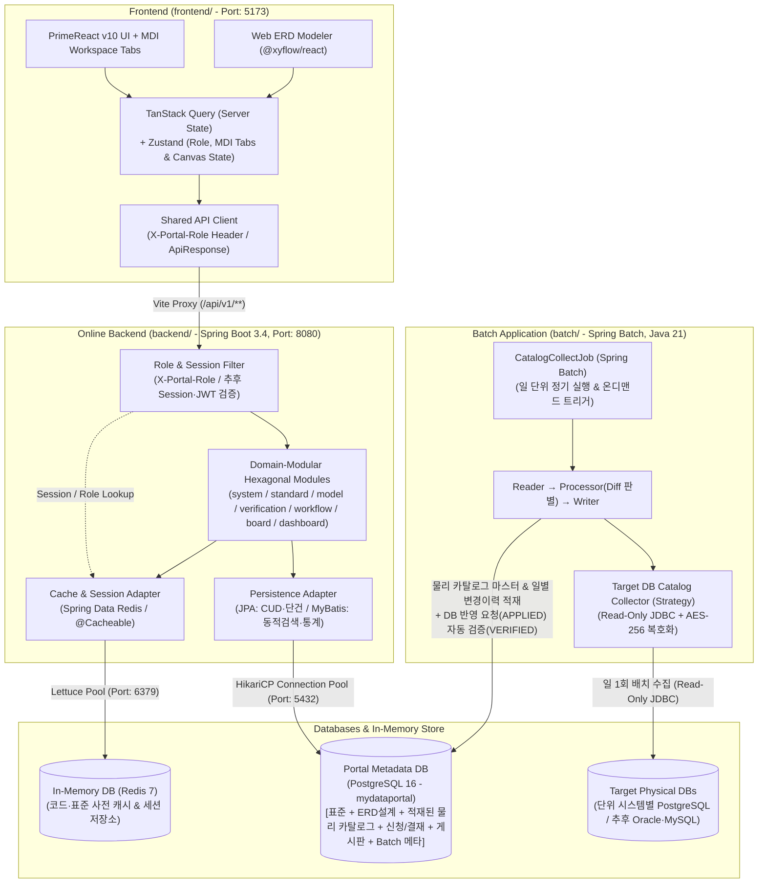

# 02. 시스템 및 패키지 아키텍처 설계서 (Architecture Specification)

## 1. 전체 시스템 아키텍처 개요 (System Architecture Overview)

**My Data Portal**은 단일 저장소(Monorepo) 내에 **`frontend/`(웹 클라이언트)**, **`backend/`(온라인 실시간 API 서버)**, **`batch/`(Spring Batch 전용 애플리케이션)** 3개의 독립 프로젝트 폴더로 분리 구성한다.
- **`backend/` (온라인 서버)**는 운영 중인 외부 물리 DB에 부하를 주지 않도록 오직 **포털 자체 DB(`mydataportal`)**와 **인메모리 DB(`Redis 7`)**만 바라보며 실시간 온라인 기능을 제공한다.
  - *(예외 경계: 시스템관리자가 `7.2 대상 물리 DB 접속 관리` 화면에서 `[DB 연결 테스트]` 버튼을 클릭할 때만 예외적으로 3초 타임아웃의 경량 `SELECT 1` 핑 확인만 수행하며, 카탈로그 메타데이터 수집은 절대 온라인 서버에서 수행하지 않고 `batch/`로 일원화한다.)*
- **`batch/` (Spring Batch 서버)**는 일 단위 정기 스케줄(또는 관리자의 온디맨드 배치 요청 트리거)로 각 단위 시스템의 **실제 물리 DB(`Target DB`)** 카탈로그를 수집하여 직전 적재분과의 변경사항(Diff)을 판별하고 포털 DB에 적재한다.



---

## 2. 기술 스택 및 버전 명세 (Technology Stack Specification)

| 계층 | 구분 | 기술 / 라이브러리 | 적용 버전 | 선정 사유 및 제약사항 |
| --- | --- | --- | --- | --- |
| **Frontend (`frontend/`)** | 코어 프레임워크 | React + TypeScript + Vite | React `^19.x`, TS `~5.8`, Vite `^6.x` | 빠른 HMR 빌드 및 엄격한 정적 타입 검증 |
| | UI 컴포넌트 | PrimeReact + PrimeIcons + PrimeFlex | **`primereact@^10.9.3`** (v10 고정) | 엔터프라이즈 그리드(`DataTable`), 분할 패널(`Splitter`), 탭(`TabView`) 제공 *(v11 업그레이드 금지)* |
| | 웹 ERD 엔진 | React Flow (`@xyflow/react`) | `^12.x` | 커스텀 테이블 노드, PK↔FK 관계선, 미니맵, 줌/패닝 지원 |
| | 상태 관리 | TanStack Query + Zustand | `@tanstack/react-query@^5.x`, `zustand@^5.x` | 서버 데이터 캐싱/무효화 및 경량 전역 상태(역할, MDI 탭, ERD 캔버스) 분리 |
| **Online Backend (`backend/`)** | 언어 & 런타임 | Java (OpenJDK) | **Java 21 (LTS)** | Record, Pattern Matching 등 최신 LTS 기능 활용 (Homebrew OpenJDK 21 경로 고정) |
| | 프레임워크 | Spring Boot | **`3.4.5`** (Gradle `8.14` Groovy DSL) | 안정적인 엔터프라이즈 웹 API 및 생태계 호환성 보장 |
| | 영속성 (CUD) | Spring Data JPA (Hibernate) | Spring Boot `3.4.5` 내장 | 엔티티 상태 관리, `@Version` 낙관적 락, JPA Auditing 지원 |
| | 영속성 (Query) | MyBatis Spring Boot Starter | **`3.0.4`** | 다중 조건 동적 검색, 설계↔물리 Gap 비교, 대시보드 통계 쿼리 최적화 |
| **Batch (`batch/`)** | 배치 프레임워크 | Spring Batch | `spring-boot-starter-batch` (`5.2.x`) | 대량 물리 DB 카탈로그 수집, 청크/스텝 기반 재시도 및 실행 메타데이터(`BATCH_*`) 관리 |
| **Database & Cache** | RDBMS | PostgreSQL | **`16-alpine`** (Port: `5432`) | 포털 메타데이터 저장 및 로컬 테스트용 샘플 타겟 스키마 호스팅 |
| | In-Memory DB | Redis | **`7-alpine`** (Port: `6379`) | 표준 사전(단어/도메인/코드) Look-Aside 캐싱 및 사용자 세션 저장소 |

---

## 3. Online Backend 아키텍처 설계 (`backend/`)

### 3.1 패키지 구조: 실용적(Pragmatic) 도메인별 헥사고날 아키텍처
온라인 실시간 기능만 담당하며, 최상위 패키지를 **7대 업무 도메인(`system`, `standard`, `model`, `verification`, `workflow`, `board`, `dashboard`)**과 **`global`(공통)**로 나누고 각 도메인 내부를 헥사고날(`domain` / `application` / `adapter`) 계층으로 구성한다.

```text
com.garfield.mydataportal
├── global/                                 # 전역 공통 모듈
│   ├── config/                             # CORS, MyBatis, JPA Auditing, Redis Cache 설정
│   ├── common/                             # ApiResponse<T>, PageResponse<T>, BaseAuditEntity(@Version 포함)
│   ├── error/                              # GlobalExceptionHandler, ErrorCode, BusinessException
│   ├── security/                           # RoleContextHolder, X-Portal-Role 검증 인터셉터, AES-256 암호화 유틸
│   └── util/
│
├── system/                                 # [도메인 1] 단위 시스템 · 대상 DB 접속정보 · 사용자 및 단위시스템별 권한 매핑
│   ├── domain/                             # TargetSystemEntity, DbConnectionInfoEntity, UserSystemAuthEntity 등
│   ├── application/
│   │   ├── port/in/                        # SystemUseCase, DbConnectionTestUseCase
│   │   ├── port/out/                       # SystemLoadPort, SystemSavePort
│   │   └── service/                        # SystemService (단위시스템/권한 관리 및 3초 타임아웃 SELECT 1 핑 테스트)
│   └── adapter/
│       ├── in/web/                         # SystemController, Request/Response DTO
│       └── out/persistence/                # SystemPersistenceAdapter (JPA Repository + MyBatis Mapper)
│
├── standard/                               # [도메인 2] 데이터 표준 사전 (단어·도메인·용어·코드·영향도 분석·개정이력)
│   ├── domain/                             # StandardWordEntity, StandardDomainEntity, StandardTermEntity, StandardRevisionHistoryEntity 등
│   ├── application/
│   │   ├── port/in/                        # StandardWordUseCase, StandardDomainUseCase, StandardTermUseCase, StandardImpactUseCase
│   │   ├── port/out/                       # StandardLoadPort, StandardSavePort
│   │   └── service/                        # 단어 조합 자동화, 분류어-도메인그룹 검증, 금칙어 체크, Where-Used 영향도 분석 서비스
│   └── adapter/
│       ├── in/web/                         # StandardWordController, StandardTermController, StandardCodeController 등
│       └── out/persistence/                # StandardPersistenceAdapter (JPA + MyBatis)
│
├── model/                                  # [도메인 3] 데이터 모델 (웹 ERD 테이블·컬럼·인덱스·관계·DDL 추출·비표준 예외·변경이력)
│   ├── domain/                             # ModelTableEntity, ModelColumnEntity, ModelIndexEntity, ModelRelationEntity, DdlGeneratorDomain 등
│   ├── application/
│   │   ├── port/in/                        # ModelDesignUseCase, DdlExportUseCase
│   │   ├── port/out/                       # ModelLoadPort, ModelSavePort
│   │   └── service/                        # ModelDesignService (ERD 저장, 인덱스 관리, 비표준 예외 기록 및 모델 변경이력 기록)
│   └── adapter/
│       ├── in/web/                         # ModelController
│       └── out/persistence/                # ModelPersistenceAdapter (JPA + MyBatis)
│
├── verification/                           # [도메인 4] 데이터베이스(물리 카탈로그/일별 변경이력) & 품질 진단 (표준 준수·Gap 비교)
│   ├── domain/                             # PhysicalTableEntity, PhysicalIndexEntity, PhysicalCatalogHistoryEntity, GapAnalysisDomain 등
│   ├── application/
│   │   ├── port/in/                        # PhysicalCatalogUseCase, ComplianceCheckUseCase, GapVerificationUseCase
│   │   ├── port/out/                       # PhysicalCatalogLoadPort, VerificationHistoryPort
│   │   └── service/                        # VerificationService (스키마+테이블+컬럼+인덱스 기준 고속 Gap 비교 및 역반영)
│   └── adapter/
│       ├── in/web/                         # PhysicalCatalogController, QualityVerificationController
│       └── out/persistence/                # VerificationPersistenceAdapter (JPA + MyBatis)
│
├── workflow/                               # [도메인 5] 통합 신청/결재 (표준 다건 묶음 신청·부분승인 & DB 반영(DDL) 요청)
│   ├── domain/                             # StdBundleRequestEntity, StdBundleRequestItemEntity, DbDdlRequestEntity 등
│   ├── application/
│   │   ├── port/in/                        # StdBundleWorkflowUseCase, DbDdlWorkflowUseCase
│   │   ├── port/out/                       # WorkflowLoadPort, WorkflowSavePort
│   │   └── service/                        # WorkflowService (단어+용어 동시 연관 신청, 항목별 부분 승인/반려, DDL 반영 상태 관리)
│   └── adapter/
│       ├── in/web/                         # WorkflowController
│       └── out/persistence/                # WorkflowPersistenceAdapter (JPA + MyBatis)
│
├── board/                                  # [도메인 6] 게시판 (공지사항 · 표준화 가이드/자료실 · Q&A)
│   ├── domain/                             # BoardPostEntity, BoardCommentEntity 등
│   ├── application/
│   │   ├── port/in/                        # BoardUseCase
│   │   ├── port/out/                       # BoardLoadPort, BoardSavePort
│   │   └── service/                        # BoardService
│   └── adapter/
│       ├── in/web/                         # BoardController
│       └── out/persistence/                # BoardPersistenceAdapter (JPA + MyBatis)
│
└── dashboard/                              # [도메인 7] 개인화 메인 대시보드 (내 신청 / 내 결재 / 내 권한 시스템 / DB 반영 요청 현황)
    ├── application/
    │   ├── port/in/                        # DashboardUseCase
    │   ├── port/out/                       # DashboardQueryPort
    │   └── service/                        # DashboardService
    └── adapter/
        ├── in/web/                         # DashboardController
        └── out/persistence/                # DashboardPersistenceAdapter (MyBatis 집계 쿼리)
```

---

### 3.2 JPA ↔ MyBatis 역할 분담(경계) 규칙
각 도메인의 `adapter/out/persistence` 내부에서 Spring Data JPA와 MyBatis의 역할을 명확히 분리한다.

| 구분 | 담당 기술 | 적용 대상 및 상세 기준 |
| --- | --- | --- |
| **Command & 단건 조회** | **Spring Data JPA** | - 모든 테이블의 엔티티(`*Entity`) 스키마 정의, `@Version` 낙관적 락 및 감사(Auditing) 필드 관리<br>- **생성(Create) · 수정(Update) · 삭제(Delete)** 및 묶음 신청/부분 승인/DDL 반영 상태 전이 비즈니스 로직<br>- **PK(ID) 기반 단건 조회** 및 단순 연관 엔티티 조회 |
| **Complex Query & 통계** | **MyBatis** | - 다중 검색 필터(키워드, 분류어 여부, 도메인 그룹, 승인 상태 등)가 결합된 **동적 검색 및 페이징 목록 조회**<br>- 표준 단어/도메인/용어의 **Where-Used(역방향 참조 영향도) 조회 쿼리**<br>- 포털 DB에 적재된 **설계 테이블/컬럼/인덱스 ↔ 물리 카탈로그 간 Gap 비교 쿼리**<br>- 단위 시스템별 **표준 준수율(%)**, **설계↔물리 일치율(%)**, **개인화 대시보드 4대 영역 집계** 쿼리 |

> **[트랜잭션 주의사항]**
> 동일한 `@Transactional` 메서드 내에서 JPA로 데이터를 변경한 직후 MyBatis 쿼리를 호출해야 하는 경우, 반드시 `entityManager.flush()`(또는 `saveAndFlush`)를 먼저 수행하여 DB와 영속성 컨텍스트 상태를 일치시킨다.

---

### 3.3 인메모리 DB(Redis 7) 캐싱 및 세션 아키텍처

| 활용 영역 | Redis Key 네임스페이스 예시 | 적용 전략 및 만료(TTL) 정책 |
| --- | --- | --- |
| **표준 코드 조회 캐시** | `portal:cache:std-code::{codeGroupId}` | - `@Cacheable` 기반 Look-Aside 캐싱 (TTL: 24시간)<br>- 코드 그룹/상세값 등록·수정·삭제 시 `@CacheEvict`로 즉시 무효화 |
| **표준 도메인 목록 캐시** | `portal:cache:std-domains` | - 전체 승인 도메인 목록 및 분류어별 매핑 도메인 캐싱 (TTL: 12시간)<br>- 전사DA가 도메인 변경 시 즉시 무효화 |
| **표준 단어 / 금칙어 사전** | `portal:cache:std-words` | - 용어 조합 자동완성 및 금칙어→대체어 즉시 변환용 캐시 (TTL: 6시간)<br>- 단어 승인 완료 시 `@CacheEvict` 수행 |
| **사용자 세션 및 권한 정보** | `portal:session:{sessionId}` | - 사용자 로그인 세션(또는 Refresh Token) 및 역할(`Role`)·담당 단위시스템 권한 목록 캐싱 (TTL: 1~2시간) |

- **직렬화(Serialization) 규칙**: Key는 `StringRedisSerializer`, Value는 `GenericJackson2JsonRedisSerializer` (JSON 포맷)를 사용한다.
- **장애 격리(Fallback)**: 일시적 Redis 연결 장애 시에도 `CacheErrorHandler`를 통해 RDB(PostgreSQL) 직접 조회로 안전하게 우회(Fallback)되도록 구성한다.

---

## 4. Batch 아키텍처 설계 (`batch/` - Spring Batch)

### 4.1 `batch/` 패키지 구조

```text
com.garfield.mydataportal.batch
├── config/                                 # Spring Batch 인프라, DataSource, 암호화 복호화 설정
├── job/                                    # Batch Job 및 Step 설정
│   ├── CatalogCollectJobConfig.java        # 일 단위 물리 DB 카탈로그 수집 Job 정의
│   └── step/
│       ├── TargetDbCatalogReader.java      # 대상 시스템·스키마별 물리 DB 카탈로그(테이블/컬럼/제약/인덱스) 수집 Reader
│       ├── CatalogDiffProcessor.java       # 직전 적재분 vs 신규 수집분 변경사항(ADDED/MODIFIED/DELETED) 판별 Processor
│       └── PhysicalCatalogWriter.java      # 포털 DB 내 물리 카탈로그 마스터 갱신, 일별 변경이력 적재 및 DDL 반영요청 자동검증 Writer
├── collector/                              # ★ 대상 물리 DB 카탈로그 수집기 (Strategy 패턴)
│   ├── TargetDbCatalogCollector.java       # DBMS 공통 수집 인터페이스
│   └── PostgresCatalogCollector.java       # PostgreSQL (information_schema, pg_catalog, pg_indexes) 수집 구현체
├── domain/                                 # 배치 처리용 도메인 모델 및 Entity
└── persistence/                            # 포털 DB 적재용 Repository / MyBatis Batch Mapper
```

### 4.2 물리 DB 카탈로그 일배치(Daily Batch) 동작 흐름 및 멱등성 보장
1. **접속 정보 로드 및 AES-256 복호화**: 포털 DB(`mydataportal`)에 등록된 활성 단위 시스템 목록과 대상 물리 DB 접속 정보를 읽고, `PORTAL_ENCRYPTION_KEY`로 비밀번호를 복호화한다.
2. **Read-Only JDBC 카탈로그 수집 (`TargetDbCatalogCollector`)**: 대상 물리 DB의 지정 스키마(`schema_name`)에 Read-Only JDBC로 연결하여 테이블, 컬럼, 데이터 타입/길이, Nullable, PK/FK, **인덱스(Index 및 구성 컬럼 순서)**, Comment 정보를 수집한 뒤 즉시 연결을 종료한다.
3. **일별 변경사항(Diff) 판별 (`CatalogDiffProcessor`)**: 포털 DB에 적재되어 있던 직전 물리 카탈로그와 오늘 수집된 카탈로그를 비교하여 신규 추가(`ADDED`), 속성 변경(`MODIFIED`), 삭제(`DELETED`)된 테이블/컬럼/인덱스를 추출한다.
4. **마스터 갱신 · 이력 적재 · DB 반영 요청 자동 검증 (`PhysicalCatalogWriter`)**:
   - 동일 기준일자(`base_date`)에 배치를 재실행하더라도 중복 이력이 쌓이지 않도록 Upsert 처리하여 **배치 멱등성(Idempotency)**을 보장한다.
   - `APPLIED(DBA 물리 반영 완료)` 상태인 **데이터베이스 반영(DDL) 요청** 대상 테이블들의 설계↔물리 Gap이 해소되었는지 확인하여 자동으로 `VERIFIED(일배치 검증 완료)` 상태로 업데이트한다.

---

## 5. REST API 공통 설계 규격 (`backend/`)

### 5.1 URL 네이밍 및 버저닝
- 모든 온라인 API는 `/api/v1` 프리픽스를 사용한다.
  - `/api/v1/dashboard/**`: 개인화 메인 대시보드(내 신청, 내 결재, 내 권한 보유 단위시스템, DB 반영 요청 현황)
  - `/api/v1/standards/{words|domains|terms|codes|integrated|impact|revisions}/**`: 데이터 표준 사전 통합/개별 조회, 참조 영향도(Where-Used) 조회, 개정 이력 조회
  - `/api/v1/models/{erd|tables|columns|indexes|ddl|histories}/**`: 웹 ERD 테이블·컬럼·인덱스·관계 관리, 정의서 조회, DDL 추출, 모델 변경이력 조회
  - `/api/v1/verifications/{catalogs|histories|compliance|gaps}/**`: 적재된 물리 카탈로그 조회, 물리 DB 일별 변경 이력, 데이터 표준 준수 진단, 설계↔물리 Gap 진단 및 역반영
  - `/api/v1/workflows/{bundle-requests|ddl-requests|approvals}/**`: 표준 다건 묶음 신청(1:N), 항목별 부분 승인/반려, 데이터베이스 반영(DDL) 요청 라이프사이클 관리
  - `/api/v1/boards/{notices|guides|qna}/**`: 공지사항, 표준화 가이드/자료실, Q&A 게시판
  - `/api/v1/systems/{targets|connections|users}/**`: 단위 시스템, 대상 물리 DB 접속 관리(경량 연결 테스트 및 온디맨드 배치 요청 포함), 사용자 및 단위시스템 권한 매핑

### 5.2 공통 응답 래퍼 (`ApiResponse<T>`)

```json
// 1. 단건/목록 성공 응답 예시
{
  "success": true,
  "data": { ... },
  "error": null
}

// 2. 페이징 성공 응답 예시 (data 내부에 PageResponse<T> 포함)
{
  "success": true,
  "data": {
    "items": [ ... ],
    "page": 0,
    "size": 20,
    "totalElements": 142,
    "totalPages": 8
  },
  "error": null
}

// 3. 실패(에러) 응답 예시
{
  "success": false,
  "data": null,
  "error": {
    "code": "STD_FORBIDDEN_WORD_DETECTED",
    "message": "'손님'은 금칙어입니다. 대체 표준 단어 '고객(CUST)'을 사용하세요.",
    "details": {
      "replacementWord": "고객",
      "replacementAbbr": "CUST"
    },
    "timestamp": "2026-11-09T15:20:00+09:00"
  }
}
```

---

## 6. 에러 처리, 보안, 동시성 제어 및 감사(Audit) 아키텍처

### 6.1 도메인별 표준 에러 코드 체계 (`ErrorCode`)
모든 비즈니스 예외(`BusinessException`)는 `GlobalExceptionHandler`에서 포착하여 HTTP 상태 코드와 도메인 접두사가 부여된 표준 에러 코드로 반환한다.

| 도메인 접두사 | 에러 코드 예시 | HTTP 상태 | 발생 상황 설명 |
| --- | --- | :---: | --- |
| `COM_*` (공통/권한) | `COM_INSUFFICIENT_PERMISSION` | `403` | 현재 역할(`X-Portal-Role`) 또는 담당 단위시스템 권한이 없는 경우 |
| | `COM_OPTIMISTIC_LOCK_CONFLICT` | `409` | 다른 사용자가 먼저 데이터를 수정하여 `@Version` 충돌이 발생한 경우 |
| `STD_*` (데이터표준) | `STD_FORBIDDEN_WORD_DETECTED` | `400` | 금칙어/유사어를 사용하여 단어 또는 용어를 신청한 경우 (대체어 정보 반환) |
| | `STD_CLASS_WORD_REQUIRED` | `400` | 표준 용어 조합 시 마지막 단어가 분류어(형식단어)가 아닌 경우 |
| | `STD_IN_USE_CANNOT_DELETE` | `409` | 하위 용어나 데이터모델 컬럼에서 참조 중인 표준을 삭제 신청한 경우 |
| `MDL_*` (데이터모델) | `MDL_DUPLICATE_TABLE_NAME` | `409` | 동일 단위시스템·스키마 내에 중복된 테이블 물리명이 존재하는 경우 |
| `WF_*` (신청/결재) | `WF_DEPENDENT_WORD_REJECTED` | `400` | 묶음 신청 부분 승인 시 선행 신규 단어가 반려되었는데 후행 용어를 승인하려는 경우 |
| `SYS_*` (시스템관리) | `SYS_DB_PING_TIMEOUT` | `504` | 대상 물리 DB `[연결 테스트]` 시 3초 이내에 응답하지 않거나 인증 실패한 경우 |

### 6.2 보안 및 동시성 제어 설계
1. **역할 및 단위시스템 권한 검증 (`RoleAuthorizationInterceptor`)**:
   - 모든 API 요청의 `X-Portal-Role` 및 `X-Portal-User-Id` 헤더를 읽어 `RoleContextHolder`(ThreadLocal)에 바인딩한다.
   - `ROLE_APP_DA`가 데이터모델을 수정하거나 DB 반영 요청을 올릴 때, 본인이 권한을 가진 단위 시스템(`UserSystemAuthEntity`)인지 서버에서 검증한다.
2. **대상 DB 비밀번호 양방향 암호화 (`Aes256CipherUtil`)**:
   - `PORTAL_ENCRYPTION_KEY` 환경변수를 사용하여 대상 물리 DB 비밀번호를 `AES/GCM/NoPadding` 방식으로 암호화 저장하며, 화면 조회 시에는 절대 복호화하지 않고 마스킹(`********`)만 반환한다.
3. **다중 사용자 동시 편집 충돌 방지 (`@Version` Optimistic Locking)**:
   - 표준 사전 엔티티 및 웹 ERD 테이블(`ModelTableEntity`)에 JPA `@Version` 컬럼(`version_no`)을 두어, 두 명의 DA가 동시에 같은 테이블을 편집해 저장할 때 후행 요청에 `409 Conflict`(`COM_OPTIMISTIC_LOCK_CONFLICT`)를 반환하고 최신 상태를 다시 불러오도록 보호한다.

### 6.3 감사(Auditing) 및 이력 자동 기록 설계
- 모든 엔티티는 `BaseAuditEntity`(`created_by`, `created_at`, `updated_by`, `updated_at`)를 상속하며, Spring Data JPA의 `AuditorAware`를 통해 `RoleContextHolder`의 현재 사용자 ID가 자동 주입된다.
- 표준 승인 및 모델 변경 시에는 별도의 개정/변경 이력 테이블(`tb_std_rev_hist`, `tb_mdl_chg_hist`)에 변경 전/후 JSON 스냅샷과 사유를 함께 기록한다.

---

## 7. Frontend 아키텍처 설계 (`frontend/`)

### 7.1 폴더 구조: Feature(도메인) 기반 모듈 구조
온라인 백엔드의 7대 도메인(`dashboard`, `standard`, `model`, `verification`, `workflow`, `board`, `system`)과 1:1로 매칭되는 `features/` 중심 구조를 채택한다.

```text
frontend/src/
├── app/                                # 앱 초기화, 라우터(AppRouter), 전역 Provider 설정
├── features/                           # 도메인별 기능 모듈 (백엔드 7대 도메인과 1:1 매칭)
│   ├── dashboard/                      # 개인화 메인 대시보드 (내 신청/결재/권한시스템/DB반영요청)
│   ├── standard/                       # 1. 데이터표준 (통합조회/단어/도메인/용어/코드 + 영향도 분석 + 인라인 신청 바구니)
│   ├── model/                          # 2. 데이터모델 (웹 ERD 캔버스, 테이블/컬럼/인덱스 정의서, 비표준 예외 설정)
│   ├── verification/                   # 3. 데이터베이스(물리 카탈로그/변경이력) & 4. 품질 진단(표준준수/Gap진단)
│   ├── workflow/                       # 5. 신청/결재 (내 신청내역, 결재 대기함[부분승인], DB 반영(DDL) 요청)
│   ├── board/                          # 6. 게시판 (공지사항, 표준화 가이드/자료실, Q&A)
│   └── system/                         # 7. 시스템 관리 (단위시스템, 물리 DB 연결/배치 트리거, 사용자/권한 매핑)
└── shared/                             # 공통 모듈
    ├── components/layout/              # TopHeaderBar, LeftSidebarMenu, MdiWorkspaceTabBar, GlobalSearchModal
    ├── api/                            # 공통 HTTP 클라이언트 (ApiResponse 언래핑, X-Portal-Role 헤더 주입)
    ├── store/                          # 전역 역할(Role) 및 열린 MDI 멀티탭 상태 스토어 (Zustand)
    └── types/                          # ApiResponse, PageResponse, RoleType 등 공통 타입
```

---

## 8. 프로그램 소스 명명 규칙 (Naming Conventions)

> ※ 포털 자체 DB의 물리 테이블/컬럼 명명 규칙은 `docs/04-database-erd.md`(데이터베이스 설계 단계)에서 별도로 정의한다.

### 8.1 Backend (`backend/`) 및 Batch (`batch/`) 명명 규칙

| 계층 / 역할 | 명명 규칙 (접미사) | 예시 |
| --- | --- | --- |
| **JPA Entity 클래스** | `{대상명}Entity` | `StandardWordEntity`, `ModelTableEntity`, `StdBundleRequestEntity` |
| **순수 Domain / 비즈니스 모델** | `{대상명}Domain` | `StandardWordDomain`, `GapAnalysisDomain`, `AlterDdlBuilderDomain` |
| **In-Port (UseCase 인터페이스)** | `{기능명}UseCase` | `StandardWordUseCase`, `StdBundleWorkflowUseCase` |
| **Application Service 구현체** | `{기능명}Service` | `StandardWordService`, `WorkflowService` |
| **Out-Port 인터페이스** | `{대상명}LoadPort`, `{대상명}SavePort` | `StandardWordLoadPort`, `StandardWordSavePort` |
| **Web REST Controller** | `{기능명}Controller` | `StandardWordController`, `WorkflowController` |
| **Web / Query DTO (`record` 권장)** | `{대상명}{동작}Request`, `{대상명}Response`, `{대상명}SearchCondition` | `StdBundleCreateRequest`, `StandardWordResponse`, `StandardWordSearchCondition` |
| **Persistence Adapter** | `{대상명}PersistenceAdapter` | `StandardWordPersistenceAdapter` |
| **Spring Data JPA Repository** | `{대상명}JpaRepository` | `StandardWordJpaRepository`, `StdBundleRequestJpaRepository` |
| **MyBatis Mapper 인터페이스/XML** | `{대상명}QueryMapper` (`.java` / `.xml`) | `StandardWordQueryMapper`, `StandardWordQueryMapper.xml` |
| **Spring Batch 구성요소 (`batch/`)** | `*JobConfig`, `*Reader`, `*Processor`, `*Writer`, `*Collector` | `CatalogCollectJobConfig`, `TargetDbCatalogReader`, `CatalogDiffProcessor`, `PhysicalCatalogWriter`, `PostgresCatalogCollector` |

- **메서드 명명 규칙 (`camelCase`)**: 단건 조회 `get*`/`find*`, 목록/검색 `get*List`/`search*Page`, 등록/신청 `create*`/`request*`, 수정/승인 `update*`/`approve*`/`reject*`, 삭제 `delete*`, 불리언 `is*`/`has*`/`can*`.

### 8.2 Frontend (React / TypeScript) 명명 규칙
- **컴포넌트 파일**: `PascalCase.tsx` (`*Page`, `*Table`, `*Modal`, `*Form`, `*Panel`, `*Node` 접미사)
- **훅/스토어/API/타입 파일**: `camelCase.ts` (`use*.ts`, `use*Store.ts`, `*Api.ts`, `*Types.ts`)
- **이벤트 핸들러**: 컴포넌트 내부 구현 함수 `handle{대상}{이벤트}`, 자식 Props 전달명 `on{대상}{이벤트}`

---

## 9. 로컬/개발 배포 환경 및 DB 형상관리 아키텍처 (Deployment & DB Strategy)

### 9.1 포트(Port) 할당 규격

| 구성 요소 | 포트 번호 | 용도 및 비고 |
| --- | :---: | --- |
| **`frontend/`** | `5173` | 실제 포털 웹 클라이언트 개발 서버 (`/api` → `localhost:8080` 프록시) |
| **`ui-prototype/`** | `5174` | 화면 레이아웃/UX 검증용 독립 프로토타입 서버 (`strictPort: true`) |
| **`backend/`** | `8080` | 온라인 실시간 REST API 서버 |
| **`batch/`** | `N/A` (`none`) | `spring.main.web-application-type: none` 기반 독립 배치 프로세스 |
| **PostgreSQL 16** | `5432` | `docker-compose.yml` 기반 포털 메타데이터 DB (`mydataportal`) |
| **Redis 7** | `6379` | `docker-compose.yml` 기반 인메모리 캐시 및 세션 DB (`my-data-portal-redis`) |

### 9.2 포털 DB 스키마 및 로컬 검증용 샘플 Target DB 구성 전략
단일 PostgreSQL 16 인스턴스(`mydataportal`) 내에서 **스키마(Schema) 분리**를 통해 포털 메타데이터와 배치 수집 테스트용 대상 물리 DB를 함께 구성한다.
- **`public` (포털 메타데이터 스키마)**: `backend/`와 `batch/`가 공유하는 포털 자체 테이블(`tb_sys_*`, `tb_std_*`, `tb_mdl_*`, `tb_phy_*`, `tb_wf_*`, `tb_brd_*`) 및 Spring Batch 메타 테이블(`BATCH_*`) 배치
- **`sample_ord` (주문관리시스템 샘플 물리 스키마)** / **`sample_hr` (인사시스템 샘플 물리 스키마)**:
  - `batch/` 애플리케이션의 카탈로그 일배치 수집과 `4.2 설계 ↔ 물리 DB 일치(Gap) 진단` 기능을 외부 DB 없이 로컬에서 즉시 검증하기 위한 테스트용 실제 물리 테이블/인덱스 스키마로 활용한다.

### 9.3 환경변수 및 비밀값(Secret) 관리
- 루트 `.env` 파일은 `.gitignore`로 제외하고 `.env.example` 템플릿으로 관리한다.
- 주요 환경변수: `DB_URL`, `DB_USERNAME`, `DB_PASSWORD`, `REDIS_HOST`, `REDIS_PORT`, `PORTAL_ENCRYPTION_KEY`(32바이트 AES-256 키).
