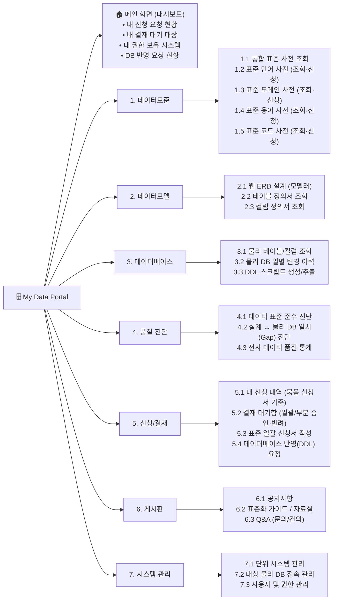
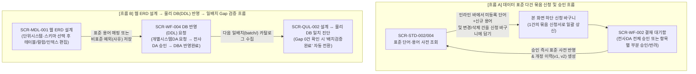

# 03. 메뉴 구조 및 화면 레이아웃 설계서 (UI/UX Design Specification)

## 1. 전체 메뉴 구조도 (Information Architecture)

- **메인 화면 (`대시보드`)**: 상단 별도 대메뉴로 두지 않고 **포털의 기본 홈 화면(로고 클릭 시 이동 및 최초 접속 시 기본 탭)**으로 제공한다.
- **상단 대메뉴 (GNB - 7개)**: **`데이터표준`** | **`데이터모델`** | **`데이터베이스`** | **`품질 진단`** | **`신청/결재`** | **`게시판`** | **`시스템 관리`**(관리자 전용)로 구성하며, 상단 대메뉴 클릭 시 좌측 사이드바(LNB)에 해당 대메뉴의 하위 메뉴들이 표시된다.



---

## 2. 전체 화면 목록 및 역할별 권한 매트릭스 (Screen Inventory & Permission Matrix)

각 하위 메뉴와 1:1 매핑되는 **화면 고유 ID(`SCR-*`)**, **라우트 경로**, **프론트엔드 페이지 컴포넌트명** 및 **역할별 접근 권한**은 다음과 같다.

| 대메뉴 | 화면 ID | 하위 메뉴명 (화면명) | 라우트 경로 (`Path`) | 대응 컴포넌트 (`*Page.tsx`) | 일반사용자 | 개별시스템DA | 전사DA | 시스템관리자 |
| --- | :---: | --- | --- | --- | :---: | :---: | :---: | :---: |
| **🏠 메인(홈)** | `SCR-DASH-001` | **메인 대시보드** | `/dashboard` | `DashboardOverviewPage` | 본인현황 | 본인+담당시스템 | 본인+전사결재 | 전체현황 |
| **1. 데이터표준** | `SCR-STD-001` | 1.1 통합 표준 사전 조회 | `/standards/integrated` | `IntegratedStandardPage` | 조회 | 조회 | 조회 | 조회 |
| | `SCR-STD-002` | 1.2 표준 단어 사전 | `/standards/words` | `StandardWordPage` | 조회+신청 | 조회+신청 | 조회+**관리** | 조회 |
| | `SCR-STD-003` | 1.3 표준 도메인 사전 | `/standards/domains` | `StandardDomainPage` | 조회 | 조회+요청 | 조회+**관리** | 조회 |
| | `SCR-STD-004` | 1.4 표준 용어 사전 | `/standards/terms` | `StandardTermPage` | 조회+신청 | 조회+신청 | 조회+**관리** | 조회 |
| | `SCR-STD-005` | 1.5 표준 코드 사전 | `/standards/codes` | `StandardCodePage` | 조회+신청 | 조회+신청 | 조회+**관리** | 조회 |
| **2. 데이터모델** | `SCR-MDL-001` | 2.1 웹 ERD 설계 (모델러) | `/models/erd` | `WebErdModelerPage` | 조회 | **담당시스템 편집** | 전사 조회/점검 | 조회 |
| | `SCR-MDL-002` | 2.2 테이블 정의서 조회 | `/models/tables` | `TableDefinitionPage` | 조회 | 조회+편집 | 조회 | 조회 |
| | `SCR-MDL-003` | 2.3 컬럼 정의서 조회 | `/models/columns` | `ColumnDefinitionPage` | 조회 | 조회+편집 | 조회 | 조회 |
| **3. 데이터베이스** | `SCR-DB-001` | 3.1 물리 테이블/컬럼 조회 | `/databases/catalogs` | `PhysicalCatalogPage` | 조회 | 조회 | 조회 | 조회 |
| | `SCR-DB-002` | 3.2 물리 DB 일별 변경 이력 | `/databases/histories` | `PhysicalChangeHistoryPage` | 조회 | 조회 | 조회 | 조회 |
| | `SCR-DB-003` | 3.3 DDL 스크립트 생성/추출 | `/databases/ddl-export` | `DdlScriptExportPage` | 조회 | **추출** | **추출** | 조회 |
| **4. 품질 진단** | `SCR-QUL-001` | 4.1 데이터 표준 준수 진단 | `/quality/compliance` | `StandardCompliancePage` | 조회 | **진단 실행** | **전사 진단** | 조회 |
| | `SCR-QUL-002` | 4.2 설계 ↔ 물리 DB 일치 진단 | `/quality/gap-analysis` | `DbGapVerificationPage` | 조회 | **진단 & 역반영** | **전사 진단** | 조회 |
| | `SCR-QUL-003` | 4.3 전사 데이터 품질 통계 | `/quality/statistics` | `QualityStatisticsPage` | 조회 | 조회 | 조회 | 조회 |
| **5. 신청/결재** | `SCR-WF-001` | 5.1 내 신청 내역 | `/workflows/my-requests` | `MyRequestHistoryPage` | **본인건** | **본인건** | **본인건** | 조회 |
| | `SCR-WF-002` | 5.2 결재 대기함 (승인/반려) | `/workflows/approvals` | `ApprovalInboxPage` | - | 담당범위 | **표준/모델 승인** | DB반영 확인 |
| | `SCR-WF-003` | 5.3 표준 일괄 신청서 작성 | `/workflows/bundle-new` | `BundleRequestCreatePage` | **신청** | **신청** | 직접등록 | - |
| | `SCR-WF-004` | 5.4 데이터베이스 반영 요청 | `/workflows/ddl-requests` | `DbDdlRequestPage` | - | **반영 요청** | **검토/승인** | **반영완료 처리** |
| **6. 게시판** | `SCR-BRD-001` | 6.1 공지사항 | `/boards/notices` | `NoticeBoardPage` | 조회 | 조회 | 작성/조회 | **작성/관리** |
| | `SCR-BRD-002` | 6.2 표준화 가이드 / 자료실 | `/boards/guides` | `StandardGuideBoardPage` | 조회 | 조회 | **작성/관리** | **작성/관리** |
| | `SCR-BRD-003` | 6.3 Q&A (문의/건의) | `/boards/qna` | `QnaBoardPage` | **작성/조회** | **작성/조회** | **답변/조회** | **답변/관리** |
| **7. 시스템 관리** | `SCR-SYS-001` | 7.1 단위 시스템 관리 | `/systems/targets` | `TargetSystemManagePage` | - | - | 조회 | **전체 관리** |
| | `SCR-SYS-002` | 7.2 대상 물리 DB 접속 관리 | `/systems/connections` | `DbConnectionManagePage` | - | - | 조회 | **전체 관리** |
| | `SCR-SYS-003` | 7.3 사용자 및 권한 관리 | `/systems/users` | `UserAuthManagePage` | - | - | - | **전체 관리** |

---

## 3. 전체 공통 화면 틀 (Global App Layout) 및 UI/UX 공통 설계 표준

### 3.1 전역 화면 레이아웃 구조
- **상단 고정 헤더(Top Header Bar — GNB)**:
  - **좌측**: 포털 로고(`My Data Portal` — 클릭 시 메인 대시보드 탭으로 이동) + **상단 대메뉴(`데이터표준` | `데이터모델` | `데이터베이스` | `품질 진단` | `신청/결재` | `게시판` | `시스템 관리`) 가로 배치**
  - **우측**: **전사 통합검색 입력창**(단어·용어·코드·모델 테이블·물리 테이블 통합 검색) + **현재 역할 전환(Role Switcher) 드롭다운**
  - *(※ 단위 시스템 선택 콤보박스는 상단 공통 헤더에 두지 않고, 단위 시스템 구분이 필요한 개별 기능 화면(데이터모델, 데이터베이스, 품질 진단 등) 내부 툴바에 배치한다.)*
- **좌측 접이식 메뉴바(Collapsible Left Sidebar — LNB)**:
  - 상단 헤더에서 선택한 **대메뉴에 속하는 하위 상세 메뉴**들을 표시한다.
  - **사이드바 접기/펴기(`<<` / `>>`) 버튼은 좌측 사이드바 영역 내부(상단 및 하단)**에 직접 부착한다.
- **우측 상단 열린 화면 멀티 탭 바(MDI Workspace Tab Bar)**:
  - 사용자가 열어 본 화면들이 상단 탭(`[🏠 메인 대시보드] [📘 표준 용어 사전 ✕] [🗂️ 웹 ERD 설계 ✕]`)으로 유지되며, 탭 전환 시에도 각 화면의 검색 조건·선택 행·작업 상태가 그대로 보존(Keep-Alive)된다.

```text
+----------------------------------------------------------------------------------------------------------+
| 🗄️ My Data Portal  [데이터표준] [데이터모델] [데이터베이스] [품질 진단] [신청/결재] [게시판]  [🔍 통합검색] [역할▼] |
+--------------------+-------------------------------------------------------------------------------------+
| 📚 데이터표준  [<<]| [🏠 메인 대시보드] [📘 표준 용어 사전 ✕] [🗂️ 웹 ERD 설계 ✕]              [전체 닫기] |
|--------------------|-------------------------------------------------------------------------------------|
|  • 통합 표준 조회  |                                  (메인 작업 영역)                                   |
|  • 표준 단어 사전  |                     열어둔 탭을 클릭하면 작업 상태 그대로 즉시 전환                 |
|  • 표준 도메인 사전|                                                                                     |
| 👉 표준 용어 사전  |    * 데이터모델 / 데이터베이스 / 품질 진단 화면에서는 내부 상단에 [단위시스템 ▼] 배치|
|  • 표준 코드 사전  |                                                                                     |
|--------------------|                                                                                     |
|     [< 사이드바접기]|                                                                                     |
+--------------------+-------------------------------------------------------------------------------------+
```

### 3.2 UI/UX 공통 인터랙션 및 상태 배지(Tag) 표준
1. **팝업(Modal) 최소화 원칙**:
   - 등록/수정/신청/상세조회/영향도 확인을 위해 별도의 모달 팝업을 띄우는 것을 최소화하고, **본 화면 내 상하 분할(Master-Detail 패널) 또는 인라인 신청 바구니**에서 한눈에 처리하도록 설계한다.
2. **상태 배지(Status Tag) 컬러 표준**:
   - 🟢 **Success (`Green`)**: `승인완료(APPROVED)`, `표준 준수(COMPLIANT)`, `완전 일치(MATCHED)`, `배치검증완료(VERIFIED)`
   - 🔵 **Info (`Blue`)**: `신규 신청(CREATE)`, `부분 승인(PARTIALLY_APPROVED)`, `DB반영완료(APPLIED)`
   - 🟡 **Warning (`Amber/Orange`)**: `검토중(PENDING)`, `변경 신청(UPDATE)`, `속성 불일치(MODIFIED)`, `설계 누락(EXTRA_IN_DB)`
   - 🔴 **Danger (`Red`)**: `반려(REJECTED)`, `삭제 신청(DELETE)`, `비표준(NON_COMPLIANT)`, `물리 DB 미구현(MISSING_IN_DB)`, `금칙어(FORBIDDEN)`
3. **그리드(DataTable) 및 피드백 공통 규칙**:
   - 모든 목록 그리드는 기본 페이지 크기 `20건`(`20 / 50 / 100` 선택 가능), 컬럼 정렬, 키워드 하이라이팅, 조회 결과 0건 시 안내 문구(Empty State)를 공통 제공한다.
   - 금칙어 감지나 분류어 누락 등 입력 오류는 입력란 하단에 즉시 인라인 가이드로 표시하며, 묶음 신청 상신·승인·반려 완료 시 우측 상단 `Toast` 알림을 표시한다.

---

## 4. 주요 업무별 화면 간 전환 흐름도 (Key User Flows)



---

## 5. 화면별 상세 레이아웃 명세 (Screen Layout Specifications)

### 5.1 [포털 메인 화면] 개인화 업무 및 거버넌스 대시보드 (`SCR-DASH-001`)

포털 로고 클릭 또는 최초 접속 시 열리는 기본 홈 화면으로, **현재 사용자의 업무 처리 현황 4대 영역**을 중심으로 구성한다.

1. **내가 신청한 등록 요청 현황 (My Requests)**: 내가 신청한 묶음 신청서(단어/용어/코드) 및 DB 반영 요청의 상태별 건수(`검토중`, `승인완료`, `부분승인`, `반려`) 및 최근 신청 목록 바로가기
2. **내 결재 대기 대상 현황 (Pending Approvals)**: 현재 사용자의 역할(`전사DA`, `개별시스템DA`, `시스템관리자`)에 따라 내가 결재·승인해야 할 대기 건수 및 `[결재하러 가기]` 바로가기
3. **내가 권한을 가지는 대상 현황 (My Authorized Systems & Models)**: `사용자 ↔ 단위시스템` 권한 매핑에 따라 내가 권한을 보유한(담당하는) 단위 시스템 목록, 각 시스템의 설계 테이블/컬럼 수, **표준 준수율(%)**, **설계↔물리 DB 일치율(%)**, `[웹 ERD 열기]` 바로가기
4. **데이터베이스(물리 DB) 반영 요청 현황 (DB Reflection Requests)**: 설계 완료된 ERD 변경분 또는 품질 진단 후 도출된 보정 DDL의 물리 DB 반영 요청 상태(`반영요청`, `검토승인`, `DB반영완료`, `배치검증완료`) 및 최근 일배치 카탈로그 수집 일시 표시

```text
+---------------------------------------------------------------------------------------------------+
| 🏠 나의 데이터 포털 워크플레이스 (메인 대시보드)                                                  |
+-------------------------------------------------+-------------------------------------------------+
| 📝 1. 내가 신청한 등록 요청 현황                | ✍️ 2. 내 결재(승인) 대기 대상                   |
|   [검토중: 3건] [승인: 18건] [부분승인: 2건]    |   [표준 승인 대기: 5건]  [DB반영 검토: 2건]     |
|   • [묶음신청] 고객 테이블 관련 3건 (검토중)    |   • [묶음] 결제/정산 표준 4건 - 신청자: 홍길동  |
|   • [코드] 배송상태코드 (DLV_STAT_CD) 승인완료  |   • [DB반영] 주문 TB_CUST 컬럼추가    [결재->]  |
+-------------------------------------------------+-------------------------------------------------+
| 🔐 3. 내가 권한을 가지는 단위시스템 현황        | 🗄️ 4. 데이터베이스(물리 DB) 반영 요청 현황       |
|   시스템명          | 테이블 | 표준준수 | DB일치 |   요청시스템 | 대상테이블  | 요청구분 | 상태     |
|   주문관리(ORD)     |  24개  |   88%   |  82%   |   주문(ORD)  | TB_CUST     | 컬럼추가 | 반영요청 |
|   정산관리(STL)     |  15개  |   90%   |  83%   |   주문(ORD)  | TB_DELIVERY | 신규생성 | 검증완료 |
+-------------------------------------------------+-------------------------------------------------+
```

---

### 5.2 [1. 데이터표준] 본 화면 일체형 조회 · 영향도 분석 · 다건 묶음 신청 (`SCR-STD-001` ~ `005`)

- **`1.1 통합 표준 사전 조회 (SCR-STD-001)`**:
  - 하나의 키워드(예: `고객`, `CUST`, `금액`)로 **표준 단어 / 표준 도메인 / 표준 용어 / 표준 코드**를 동시에 검색한다.
  - 특정 표준 항목 선택 시 하단 탭에서 **① 참조 영향도(Where-Used: 해당 단어/도메인을 사용 중인 표준 용어 및 단위시스템별 모델 테이블·컬럼 목록)**와 **② 표준 개정 이력(`v1`, `v2`... 변경 전/후 비교)**을 즉시 확인한다.
- **`1.2 ~ 1.5 개별 표준 사전 조회 및 인라인 묶음 신청 (SCR-STD-002 ~ 005)`**:
  - **팝업 최소화 및 다건 묶음 신청 바구니**: 상단 목록에서 기존 표준의 `[변경 담기]`/`[삭제 담기]`(단, 하위 참조 중인 항목은 삭제 담기 차단 안내) 및 인라인 입력 바에서의 `[+ 신규 신청 담기]`를 통해 본 화면 하단 **신청 바구니**에 여러 건을 모아서 **1건의 묶음 신청서**로 상신한다.
  - **미등록 단어 + 신규 용어 동시 연관 신청**: 신규 용어 조합 중 미등록 단어가 감지되면 인라인 바에서 미등록 단어의 영문약어를 즉시 입력하여 단어와 용어를 한 장바구니에 함께 담는다.

```text
+---------------------------------------------------------------------------------------------------+
| 📘 표준 용어 사전 (조회 · 영향도/개정이력 확인 · 일괄 묶음 신청)                                  |
+---------------------------------------------------------------------------------------------------+
| [검색어: 고객      ] [도메인그룹: 전체 ▼] [상태: 승인 ▼]                  [🔍 조회] [초기화]      |
+---------------------------------------------------------------------------------------------------+
| 📄 1. 등록된 표준 용어 목록 (행 선택 시 우측/하단에서 사용처(Where-Used) 및 개정이력 확인 가능)   |
| 체크 | 한글 용어명  | 영문 컬럼명 | 단어 조합   | 도메인   | 타입        | 모델사용처 | 작업      |
| [v]  | 고객번호     | CUST_NO     | 고객+번호   | 번호_V20 | VARCHAR(20) | 4개 테이블 | [변경담기]|
| [ ]  | 고객식별코드 | CUST_ID_CD  | 고객+식별+코드| 코드_C10| CHAR(10)    | 0개 테이블 | [변경][삭제]|
+===================================================================================================+
| ✍️ 2. 본 화면 인라인 용어 조합 / 편집 바 (미등록 단어 감지 시 단어+용어 동시 담기 지원)           |
| 구분:[신규▼] 한글명:[고객식별번호] -> 단어분리:[고객(CUST) + ⚠️식별(미등록:IDNT 입력) + 번호(NO)]|
| 자동영문명:[CUST_IDNT_NO]  추천도메인:[번호_V20 (VARCHAR(20)) ▼]   [+ 미등록 단어&용어 함께 담기] |
+---------------------------------------------------------------------------------------------------+
| 📦 3. 이번 묶음 신청서에 담긴 항목 목록 (총 3건 — 단어신규 1건, 용어신규 1건, 용어변경 1건)       |
| 번호 | 대상 | 신청구분 | 한글명       | 영문명/약어   | 도메인/분류어 | 데이터 타입 | 사유   | 빼기|
|  1   | 단어 | [신규]   | 식별         | IDNT          | 일반단어      | -           | 용어조합용| [✕]|
|  2   | 용어 | [신규]   | 고객식별번호 | CUST_IDNT_NO  | 번호_V20      | VARCHAR(20) | 신규컬럼 | [✕]|
|  3   | 용어 | [변경]   | 고객번호     | CUST_NO       | 번호_V30      | VARCHAR(30) | 길이확대 | [✕]|
|---------------------------------------------------------------------------------------------------|
| 묶음 신청 제목: [ 주문시스템 고객식별번호 관련 단어/용어 3건 일괄 신청 ] [비우기] [🚀 묶어 신청하기]|
+---------------------------------------------------------------------------------------------------+
```

---

### 5.3 [2. 데이터모델] 웹 ERD 설계 및 테이블/컬럼 정의서 화면 (`SCR-MDL-001` ~ `003`)
- 화면 상단 툴바에 **`[대상 단위시스템 선택 ▼]`** 및 **`[대상 스키마 선택 ▼]`** 콤보박스를 배치한다 (내 권한 보유 시스템이 상단에 우선 표시됨).
- **`2.1 웹 ERD 설계 (SCR-MDL-001)`**:
  - **위쪽(60%) 인터랙티브 ERD 캔버스**: 마우스 드래그 테이블 배치, PK↔FK 관계선 연결, `[논리(한글) | 물리(영문) | 논리+물리]` 뷰 전환
  - **아래쪽(40%) 선택 테이블의 상세 편집 탭 (`[컬럼 목록]` | `[인덱스(Index) 목록]` | `[모델 변경이력]`)**:
    - 표준 용어 자동완성 검색을 통한 컬럼 추가를 기본으로 하며, 불가피한 경우 **`[표준 예외(비표준) 허용]` 체크 및 `예외 사유` 입력**으로 저장 가능 (`[⚠️ 비표준]` 배지 표시)
    - **`[인덱스 목록]` 탭**: 인덱스 물리명, Unique 여부, 복합 인덱스 구성 컬럼 및 정렬 순서(`ASC`/`DESC`) 편집
    - 설계 완료 후 우측 상단 **`[🗄️ DB 반영(DDL) 요청]`** 버튼으로 물리 DB 적용을 요청할 수 있다.
- **`2.2 테이블 정의서 조회 (SCR-MDL-002)` / `2.3 컬럼 정의서 조회 (SCR-MDL-003)`**:
  - ERD 캔버스 없이 단위시스템·스키마 전체의 설계 테이블 목록과 전체 설계 컬럼 목록(표준 매핑 여부, 도메인, PK/FK, 비표준 사유 포함)을 대량 그리드로 빠르게 필터링·검색·편집하는 화면이다.

---

### 5.4 [3. 데이터베이스] 물리 DB 카탈로그 조회 · 변경 이력 · DDL 추출 (`SCR-DB-001` ~ `003`)
- 화면 상단 툴바에 **`[대상 단위시스템 선택 ▼]`**, **`[스키마 선택 ▼]`** 및 **`최근 일배치 수집 일시`**를 표시한다.
- **`3.1 물리 테이블/컬럼 조회 (SCR-DB-001)`**: Spring Batch(`batch/`)가 적재한 실제 물리 DB의 테이블 목록(좌측)과 컬럼·타입·PK/FK·**인덱스(Index)**·코멘트 명세(우측)를 운영 DB 부하 없이 포털 DB에서 즉시 조회한다.
- **`3.2 물리 DB 일별 변경 이력 (SCR-DB-002)`**: 직전 적재분 대비 일배치에서 감지된 물리 스키마 변경 내역(테이블/컬럼/인덱스 `ADDED`, `MODIFIED`, `DELETED`)을 일자별로 조회한다.
- **`3.3 DDL 스크립트 생성/추출 (SCR-DB-003)`**: 단위시스템의 전체 또는 선택한 설계 테이블들에 대해 실행 가능한 PostgreSQL DDL(`CREATE TABLE`, `ALTER TABLE ADD CONSTRAINT`, `CREATE INDEX`, `COMMENT ON`)을 일괄 생성·복사·다운로드한다.

---

### 5.5 [4. 품질 진단] 표준 준수 진단 · 설계↔물리 Gap 진단 · 품질 통계 (`SCR-QUL-001` ~ `003`)
- **`4.1 데이터 표준 준수 진단 (SCR-QUL-001)`**: 단위 시스템의 설계 컬럼 중 미등록 용어 사용, 도메인 타입/길이 불일치, 비표준 예외 등록 컬럼을 일괄 검출하고, 비표준 컬럼에서 바로 `[표준 단어/용어 묶음 신청 담기]`로 연계한다.
- **`4.2 설계 ↔ 물리 DB 일치(Gap) 진단 (SCR-QUL-002)`**:
  - **좌측**: 스키마·테이블별 판정 결과(`✅ 완전 일치`, `⚠️ 속성/인덱스 불일치`, `🚨 물리 DB 미구현`, `❓ 설계 누락`)
  - **우측 상단**: 선택 테이블의 `설계 명세(데이터모델)` vs `물리 명세(데이터베이스)` 컬럼 및 인덱스 1:1 비교 표
  - **우측 하단**: 불일치 해결을 위한 **자동 생성 보정 SQL(`CREATE` / `ALTER TABLE` / `CREATE INDEX`)** 및 **`[🗄️ 이 SQL로 DB 반영 요청하기]`** / **`[📥 물리 DB 기준으로 설계 역반영]`** 버튼 제공
- **`4.3 전사 데이터 품질 통계 (SCR-QUL-003)`**: 전사 모든 단위시스템의 테이블/컬럼 수, 표준 준수율(%), 물리 DB 일치율(%) 추이를 비교 리포트로 표시한다.

---

### 5.6 [5. 신청/결재] 통합 신청 및 결재 워크플로우 화면 (`SCR-WF-001` ~ `004`)
- **`5.1 내 신청 내역 (SCR-WF-001)` / `5.2 결재 대기함 (SCR-WF-002)`**:
  - 상단 목록에서 묶음 신청서(마스터) 클릭 시 하단에 신청서에 포함된 **N개의 상세 신청 항목 목록**(신규 단어, 신규 용어, 변경 용어 등)과 **참조 영향도 건수**가 펼쳐진다.
  - 결재권자(`전사DA`)는 **`[전체 일괄 승인]` / `[전체 반려]`** 뿐만 아니라, 상세 항목별로 **`[승인]` / `[반려(개별 반려 사유 입력)]`을 선택하여 부분 승인(`PARTIALLY_APPROVED`)** 처리할 수 있다.
- **`5.3 표준 일괄 신청서 작성 (SCR-WF-003)`**: 단어·용어·코드 구분 없이 한 화면에서 여러 신청 항목을 작성·편집하여 묶음 상신하는 전용 화면이다.
- **`5.4 데이터베이스 반영(DDL) 요청 (SCR-WF-004)`**:
  - `1. 반영 요청(REQUESTED)` → `2. 검토/승인(APPROVED)` → `3. 물리 DB 적용 완료(APPLIED)` → `4. 일배치 수집 후 Gap 해소 자동 검증(VERIFIED)`의 4단계 진행 상태와 실행 대상 DDL 스크립트를 조회·처리한다.

---

### 5.7 [6. 게시판] 및 [7. 시스템 관리] 화면 (`SCR-BRD-001` ~ `003`, `SCR-SYS-001` ~ `003`)
- **`6.1 공지사항 / 6.2 표준화 가이드·자료실 / 6.3 Q&A (SCR-BRD-001 ~ 003)`**:
  - 팝업 없이 상단 게시글 목록과 하단 본문/답변 열람·작성 패널로 구성하여 빠르게 표준화 지침을 확인하거나 질의응답을 등록한다.
- **`7.1 단위 시스템 관리 (SCR-SYS-001)`**: 단위 시스템 코드, 명칭, 설명, 사용 여부 등록 및 수정.
- **`7.2 대상 물리 DB 접속 관리 (SCR-SYS-002)`**: 단위 시스템별 JDBC 접속 정보(대상 스키마 목록 포함) 입력, **`[🔌 DB 연결 테스트 (3초 SELECT 1)]`** 버튼, 일배치 스케줄 설정 및 **`[▶ 즉시 카탈로그 수집(온디맨드 배치) 실행]`** 버튼, 최근 배치 실행 로그 조회 패널 제공.
- **`7.3 사용자 및 권한 관리 (SCR-SYS-003)`**: 사용자 목록, 포털 4단계 역할 지정, 그리고 좌우 매핑 패널을 통한 **`사용자 ↔ 담당 단위시스템(1:N)` 권한 부여** 화면 제공.
