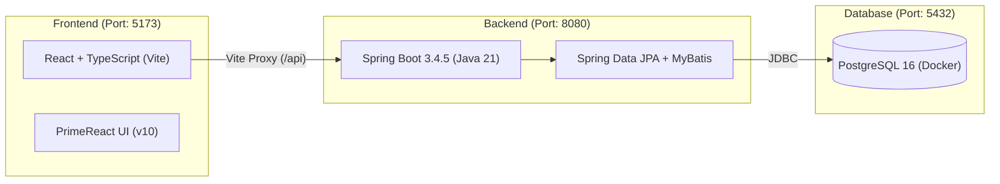

# 작업 요약 보고서 (2026-10-28)

## 1. 작업 개요
- **작업 일자**: 2026년 10월 28일
- **대상 저장소**: [https://github.com/Garfield90/my-data-portal.git](https://github.com/Garfield90/my-data-portal.git)
- **연관 GitHub 이슈**: [Issue #1 - [Init] 프론트엔드(React + PrimeReact) 및 백엔드(Spring Boot) 초기 아키텍처 구성](https://github.com/Garfield90/my-data-portal/issues/1)
- **목표**: `my-data-portal` 프로젝트의 GitHub 원격 저장소 연동, 기술 스택 확정 및 프론트엔드·백엔드·데이터베이스 초기 개발 환경 구축

---

## 2. 확정된 시스템 아키텍처 및 기술 스택



| 구분 | 선택 기술 | 선정 사유 및 상세 내용 |
| --- | --- | --- |
| **구조** | `frontend/`, `backend/` 분리 | 단일 레포지토리 내 독립 실행 구조, 개발 시 Vite Proxy로 `/api` 연동 |
| **Frontend** | Vite + React + TypeScript | 빠른 번들링 속도 및 PrimeReact 컴포넌트 타입 자동완성 지원 |
| **UI 라이브러리** | PrimeReact (`^10.9.3`), PrimeIcons, PrimeFlex | 데이터 포털 대시보드·테이블 구성에 적합한 컴포넌트 제공 |
| **Backend** | Java 21 (LTS) + Spring Boot 3.4.5 | 최신 LTS 자바 버전 및 안정적인 Spring Boot 3.x 생태계 활용 |
| **빌드 도구** | Gradle 8.14 (Groovy DSL, Wrapper 포함) | 레퍼런스가 풍부하고 간결한 빌드 스크립트 구성 |
| **데이터 접근** | Spring Data JPA + MyBatis (`3.0.4`) 혼용 | 기본 CRUD는 JPA로 생산성을 높이고, 복잡한 통계/포털 쿼리는 MyBatis 활용 |
| **Database** | PostgreSQL 16 (`docker-compose.yml`) | 데이터 포털 메타데이터 및 통계/JSON 처리에 적합한 오픈소스 RDBMS |

---

## 3. 단계별 진행 내역

### 3.1 GitHub 저장소 연동 및 이슈 등록
1. 로컬 작업 폴더(`/Users/garfield/intellij-projects/my-data-portal`)에 원격 저장소(`origin`) 클론 및 연동
2. Homebrew를 통해 GitHub CLI(`gh`) 설치 및 계정 인증(`Garfield90`) 완료
3. 요구사항 질의응답을 통해 구체화된 아키텍처 사양을 **GitHub Issue #1**에 등록 및 업데이트

### 3.2 루트 공통 환경 및 DB 컨테이너 설정
- [docker-compose.yml](file:///Users/garfield/intellij-projects/my-data-portal/docker-compose.yml): PostgreSQL 16(`postgres:16-alpine`) 컨테이너 설정
  - DB명: `mydataportal` / 계정: `portal_user` / 비밀번호: `portal_password` / 포트: `5432`
- [.gitignore](file:///Users/garfield/intellij-projects/my-data-portal/.gitignore): macOS, IntelliJ(`.idea`), Node(`node_modules`), Gradle(`.gradle`, `build`) 등 제외 규칙 설정
- [README.md](file:///Users/garfield/intellij-projects/my-data-portal/README.md): 프로젝트 구조 및 실행 가이드 문서화

### 3.3 백엔드(`backend/`) 초기 구축
- [build.gradle](file:///Users/garfield/intellij-projects/my-data-portal/backend/build.gradle): Spring Web, Spring Data JPA, Validation, MyBatis Starter(`3.0.4`), PostgreSQL 드라이버, Lombok 의존성 구성
- [application.yml](file:///Users/garfield/intellij-projects/my-data-portal/backend/src/main/resources/application.yml):
  - PostgreSQL 데이터소스 연동 설정
  - Hibernate/JPA 설정(`ddl-auto: update`, `open-in-view: false`)
  - MyBatis 매퍼 경로(`classpath*:mapper/**/*.xml`) 및 카멜케이스 자동 매핑 설정
- [`WebConfig`](file:///Users/garfield/intellij-projects/my-data-portal/backend/src/main/java/com/garfield/mydataportal/config/WebConfig.java): 프론트엔드(`http://localhost:5173`)와의 통신을 위한 `/api/**` CORS 허용 설정
- [`HealthController`](file:///Users/garfield/intellij-projects/my-data-portal/backend/src/main/java/com/garfield/mydataportal/controller/HealthController.java) & [`SystemHealthMapper`](file:///Users/garfield/intellij-projects/my-data-portal/backend/src/main/java/com/garfield/mydataportal/mapper/SystemHealthMapper.java) & [SystemHealthMapper.xml](file:///Users/garfield/intellij-projects/my-data-portal/backend/src/main/resources/mapper/SystemHealthMapper.xml):
  - `GET /api/health` 호출 시 서버 상태, Java 버전, MyBatis를 통한 PostgreSQL 연결 상태(`SELECT version()`)를 반환하는 헬스체크 API 구현

### 3.4 프론트엔드(`frontend/`) 초기 구축
- [vite.config.ts](file:///Users/garfield/intellij-projects/my-data-portal/frontend/vite.config.ts): 개발 서버 포트(`5173`) 고정 및 `/api` 요청을 `http://localhost:8080`으로 전달하는 프록시 설정
- [main.tsx](file:///Users/garfield/intellij-projects/my-data-portal/frontend/src/main.tsx): `PrimeReactProvider` 적용 및 테마(`lara-light-blue`), 아이콘(`primeicons`), 유틸리티(`primeflex`) 스타일시트 로드
- [App.tsx](file:///Users/garfield/intellij-projects/my-data-portal/frontend/src/App.tsx):
  - PrimeReact의 `Menubar`, `Card`, `Tag`, `Button`, `DataTable`을 활용한 초기 포털 대시보드 화면 구성
  - 백엔드 `/api/health` API를 호출하여 실시간 서버 상태 및 DB 연동 여부를 화면에 표시

---

## 4. 트러블슈팅 및 해결 내역

1. **백엔드 Gradle 빌드 시 `JAVA_HOME` 환경변수 오류**
   - **원인**: macOS에서 Homebrew로 설치된 OpenJDK 21 경로(`/opt/homebrew/opt/openjdk@21/...`)가 기본 셸 또는 IDE의 `JAVA_HOME`에 지정되어 있지 않아 `gradlew` 실행 초기 단계에서 오류 발생
   - **해결**:
     - [backend/gradle.properties](file:///Users/garfield/intellij-projects/my-data-portal/backend/gradle.properties)에 `org.gradle.java.home=/opt/homebrew/opt/openjdk@21/libexec/openjdk.jdk/Contents/Home` 명시
     - [backend/gradlew](file:///Users/garfield/intellij-projects/my-data-portal/backend/gradlew#L119-L127) 스크립트 상단에 `JAVA_HOME` 미설정 시 Homebrew OpenJDK 21 경로를 자동 탐지하도록 보완
     - 검증 결과: `./gradlew compileJava` 성공 (`BUILD SUCCESSFUL`)

2. **프론트엔드 PrimeReact 타입 및 빌드 호환성 이슈**
   - **원인**: `npm install primereact` 실행 시 실험적 구조가 변경된 v11 패키지가 설치되어 기존 컴포넌트(`Menubar`, `Card`, `DataTable`) import 시 TypeScript 컴파일 에러 발생
   - **해결**:
     - [frontend/package.json](file:///Users/garfield/intellij-projects/my-data-portal/frontend/package.json)에서 검증된 안정 버전인 `primereact@^10.9.3`, `primeicons@^7.0.0`, `primeflex@^3.3.1`로 버전을 고정하여 재설치
     - 검증 결과: `npm run build` (`tsc -b && vite build`) 정상 통과

---

## 5. 실행 및 확인 명령어

```bash
# 1. PostgreSQL 컨테이너 시작
docker compose up -d

# 2. 백엔드 서버 실행 (http://localhost:8080)
cd backend
./gradlew bootRun

# 3. 프론트엔드 개발 서버 실행 (http://localhost:5173)
cd frontend
npm run dev
```
